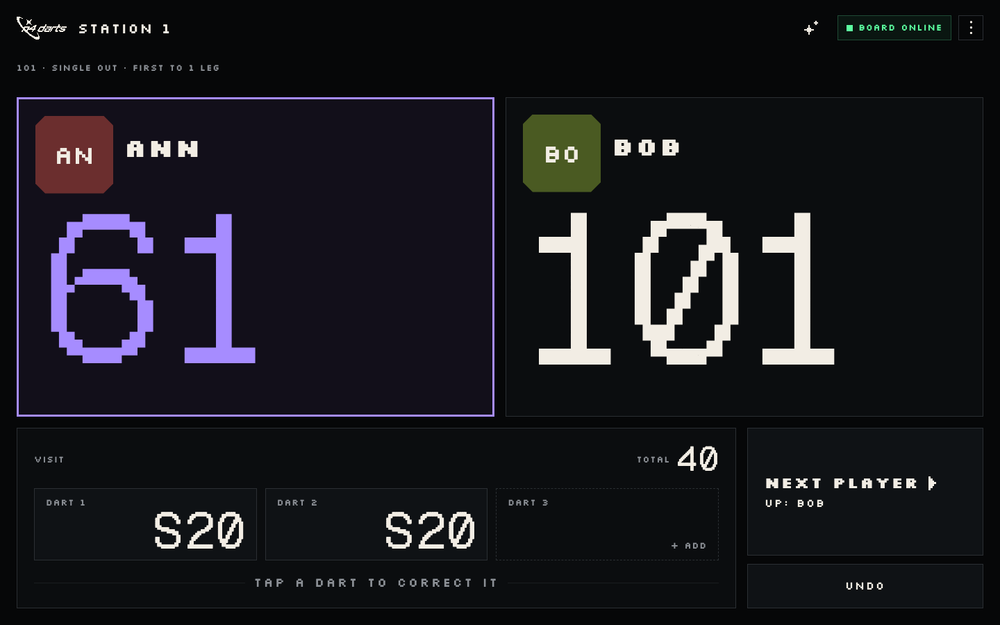
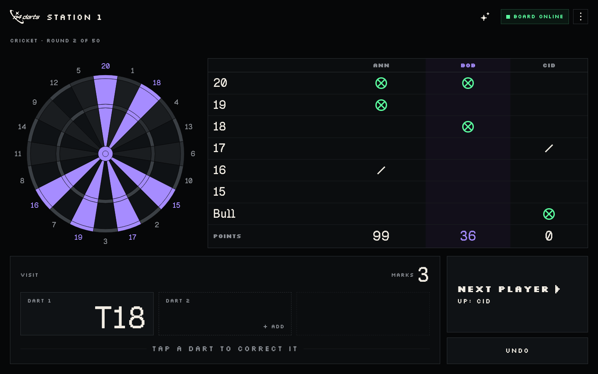
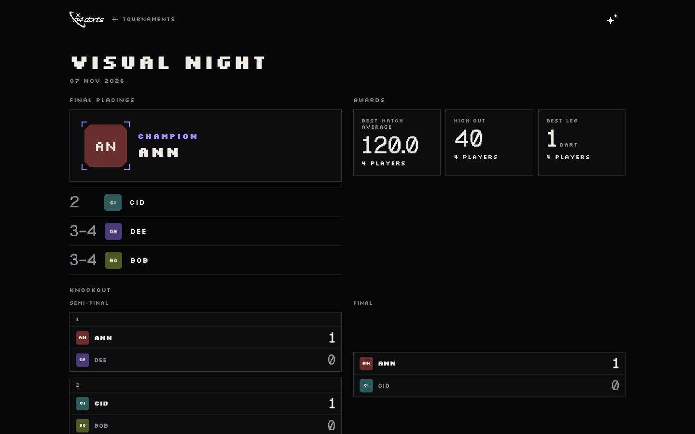
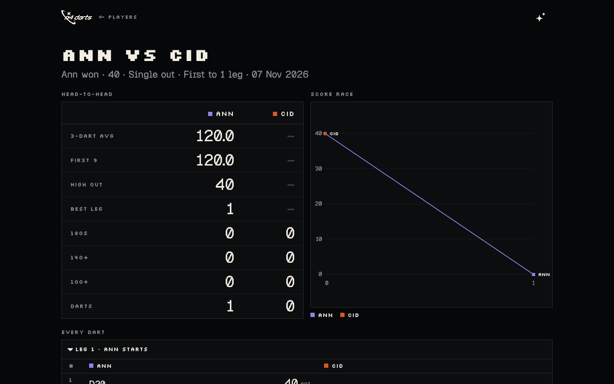
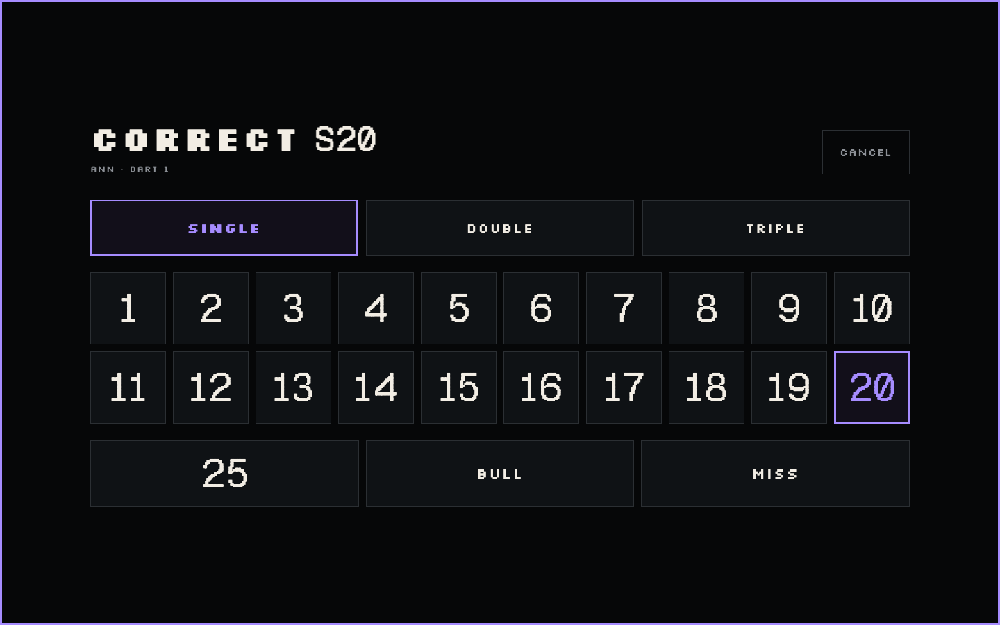
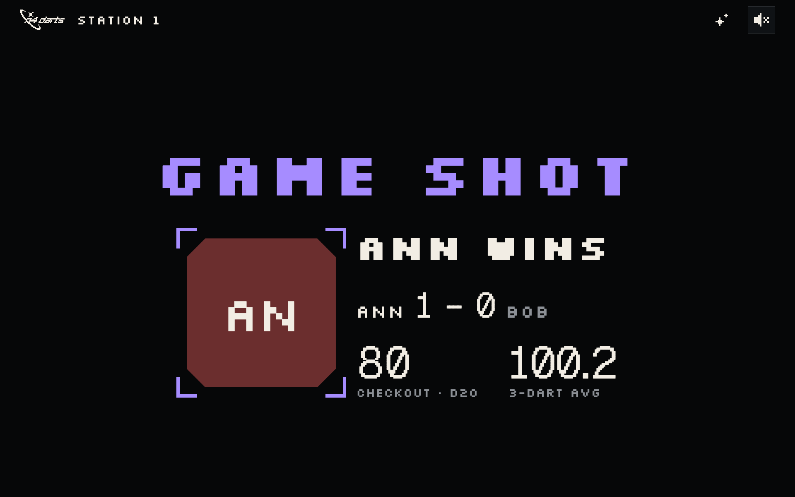
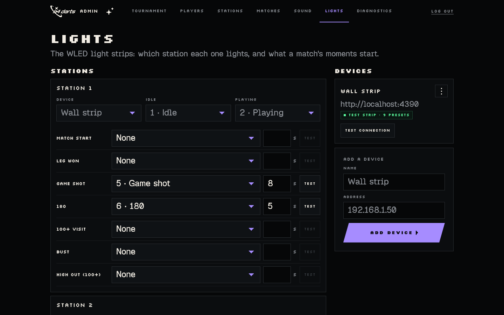
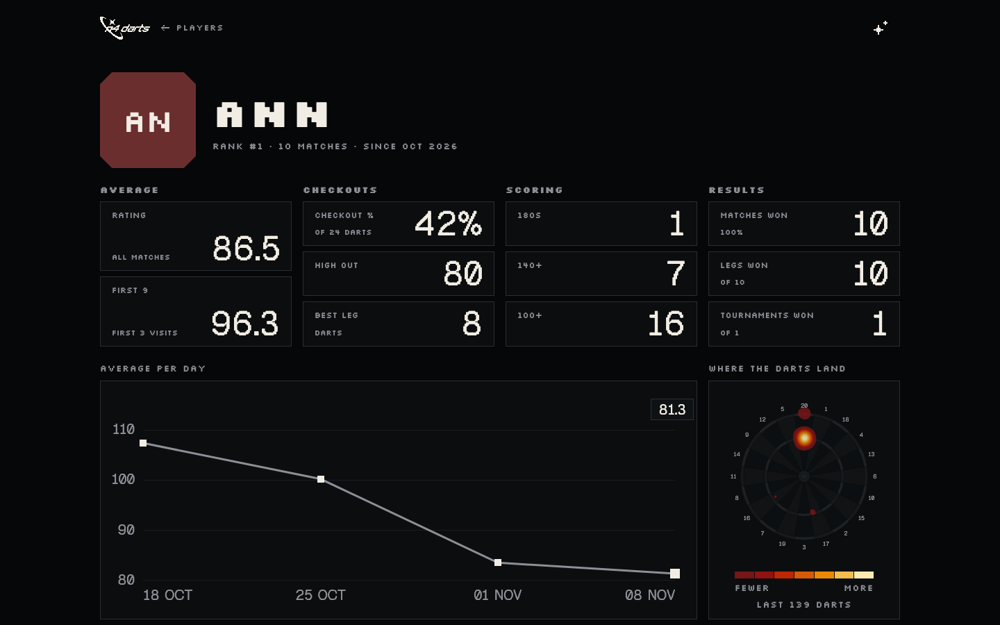
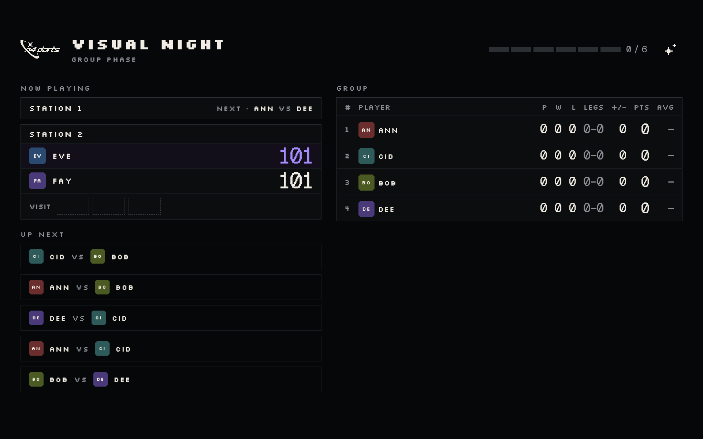

<p align="center">
  <picture>
    <source media="(prefers-color-scheme: dark)" srcset="logo.svg">
    
  </picture>
</p>

<p align="center">
  <b>Create dart matches &amp; organize tournaments, fully offline and open source.</b><br>
  Depends on Autodarts Board Manager for automatic dart detection.
</p>

<p align="center">
  
  
  <br>
  <a href="https://github.com/sverbach/n4-darts/actions/workflows/ci.yml"></a>
  <a href="https://github.com/sverbach/n4-darts/pkgs/container/n4-darts"></a>
  <a href="LICENSE"></a>
</p>

<p align="center">
  <a href="#features">Features</a> ·
  <a href="#running-on-the-server">Running on the server</a> ·
  <a href="#development">Development</a> ·
  <a href="docs/architecture/README.md">Architecture</a>
</p>

<br>

<p align="center">
  
  <br>
  <sub>The station screen next to the board, mid-visit in a 101.</sub>
</p>

<br>

## Features

<table>
  <tr>
    <td width="50%" valign="top">
      
      <h3>Games</h3>
      X01 (301/501/701, in and out rules, first to N legs) and various party games like Around the Clock, Golf, Killer, Cricket and more!
    </td>
    <td width="50%" valign="top">
      
      <h3>Tournaments</h3>
      Create single or double elimination tournaments, including group phases &amp; seeding.
    </td>
  </tr>
  <tr>
    <td width="50%" valign="top">
      
      <h3>Stats</h3>
      Tracks ratings, averages, checkout %, 180s, best leg and more.
    </td>
    <td width="50%" valign="top">
      
      <h3>Stations</h3>
      Connect any station in your dart room to the system. Requires each station to have the Autodarts Board Manager running (manual counting also possible).
    </td>
  </tr>
  <tr>
    <td width="50%" valign="top">
      
      <h3>Caller</h3>
      Integrated voice caller with the option to upload your custom voice packs.
    </td>
    <td width="50%" valign="top">
      
      <h3>Lights</h3>
      Integrated WLED to run presets at certain match states.
    </td>
  </tr>
  <tr>
    <td width="50%" valign="top">
      
      <h3>Public site</h3>
      A read-only version of the application to host publicly.
    </td>
    <td width="50%" valign="top">
      
      <h3>Projector</h3>
      A live view of tournaments for big screens &amp; projectors.
    </td>
  </tr>
</table>

<br>

## Running on the server

Images are published to the public `ghcr.io/sverbach/n4-darts:latest`, so the easiest way to run it is by pulling the image:

```sh
docker compose pull && docker compose up -d
```

Then open `http://<server>:3000/`.

### Environment variables

| Variable           | Description                                                                                                                                 |
| ------------------ | ------------------------------------------------------------------------------------------------------------------------------------------- |
| `N4_STATIONS`      | Seeds the boards on the very first start, e.g. `1=http://192.168.1.139:3180,2=http://…`. After that they're managed in `/admin` → Stations. |
| `N4_ADMIN_PIN`     | Locks `/admin`. Without it, `/admin` is open.                                                                                               |
| `N4_PORT`          | Port of the app (default 3000).                                                                                                             |
| `N4_PUBLIC_PIN`    | The group password for the public site.                                                                                                     |
| `N4_PUBLIC_PORT`   | Port of the public site, on `127.0.0.1` only (default 3001).                                                                                |
| `COMPOSE_PROFILES` | Set to `public` to also start the public site (same as `--profile public`; use this in Portainer).                                          |

### Data

Data is stored in the `n4-data` volume (SQLite).

> [!TIP]
> **Backups:** once a day the database is copied to `/data/backups` in the volume, and the newest 30 are kept. They're on the same disk, so copy one elsewhere now and then.

To restore a backup:

```sh
docker compose stop
docker compose run --rm --no-deps --entrypoint sh n4-darts -c \
  'cd /data && rm -f n4-darts.db-wal n4-darts.db-shm && cp backups/n4-darts-{yyyy}-{mm}-{dd}-{HHMM}.db n4-darts.db'
docker compose up -d
```

<br>

## Development

Requires Node 22+ and pnpm 12.

```sh
pnpm install
pnpm dev:sim     # the app on :5173 with two fake boards (:3180, :3181) and a fake WLED strip (:3190)
pnpm dev         # the same without fakes; real boards with STATIONS=1=http://192.168.1.139:3180
pnpm test        # unit and integration tests
pnpm lint && pnpm typecheck
pnpm build && pnpm start   # production build on :3000
pnpm build && pnpm e2e     # browser tests (Playwright), the same as CI
pnpm --filter @n4/e2e visual   # screenshot comparison, by hand (macOS baseline); add --update-snapshots
pnpm db:reset    # clear the dev database (server stopped)
tools/readme-shots/shots.sh   # the README's screenshots, cut from the visual baselines
```

### Code structure

| Path                 | What                                                          |
| -------------------- | ------------------------------------------------------------- |
| `packages/engine`    | The game rules, X01 and party modes; pure, shared with the UI |
| `packages/server`    | Node server: board gateway, matches, tournaments, stats, API  |
| `packages/web`       | React app                                                     |
| `packages/e2e`       | Browser and visual tests                                      |
| `tools/board-sim`    | Fake Board Manager (2.0.2 API, `docs/board-manager-api.md`)   |
| `tools/wled-sim`     | Fake WLED controller                                          |
| `tools/callouts`     | The built-in caller voice and the voice-pack importer         |
| `tools/readme-shots` | The README's screenshots, from the visual suite               |

More: [`docs/architecture/`](docs/architecture/README.md) (arc42), [`docs/adr/`](docs/adr/) (decisions), [`GLOSSARY.md`](GLOSSARY.md), [`docs/ui-pages.md`](docs/ui-pages.md).

<br>

<p align="center">
  <sub>MIT licensed · Made for dart friends <3</sub>
</p>
