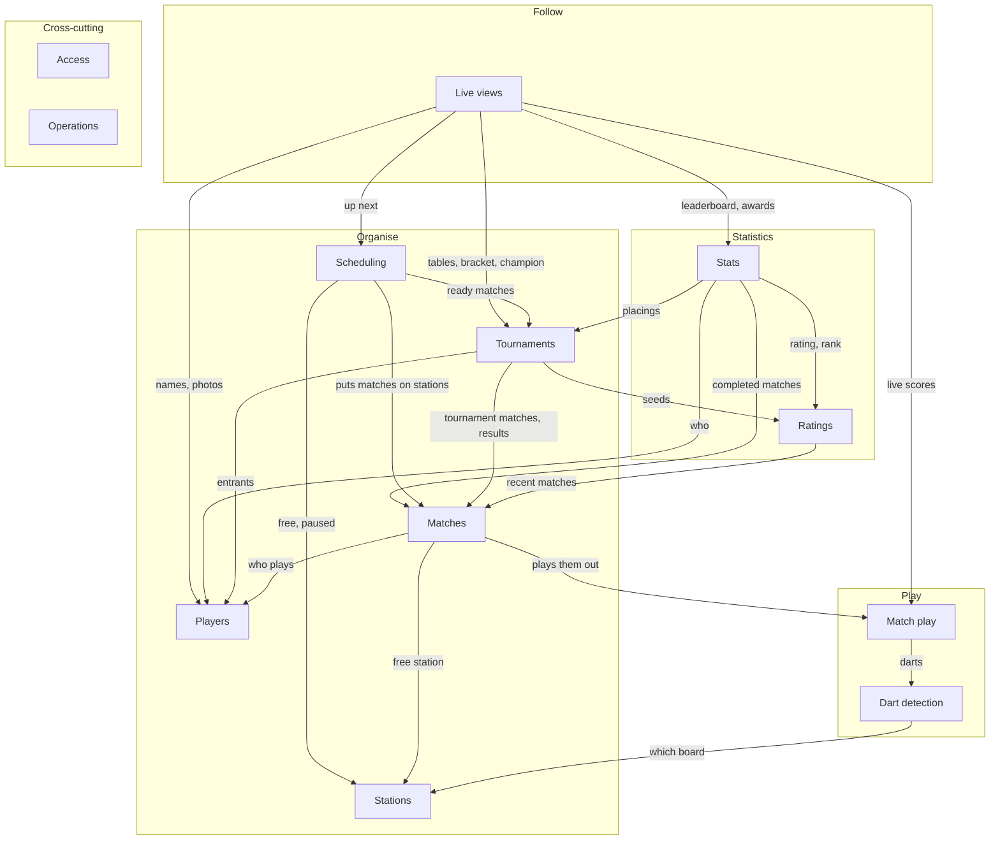
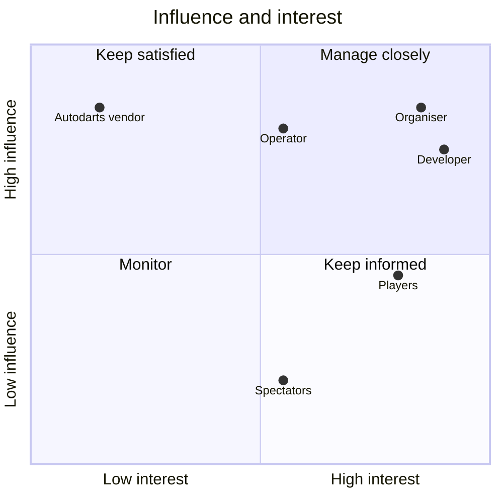

# 1. Introduction and goals

n4-darts runs private, offline dart tournaments in a room with automatically scored boards. An organiser sets up a tournament on a local server, the server gives each match to a free station, and players walk up and play. Autodarts boards detect the darts; everything else (scoring, matches, tournaments, stats) is n4-darts' own. No accounts, no logins, no internet.

## 1.1 Requirements overview

### Function overview

The functions of n4-darts, clustered by what they're for, and how the clusters depend on each other. It stays at the business level: what each cluster does, not how it's built. Requirement IDs refer to the tables below; stakeholders to section 1.3.

The clusters fall into five groups:
- **Play**: what happens at the board.
- **Organise**: what the organiser sets up and the evening runs on.
- **Statistics**: the long-term numbers about each player, built up from their finished matches over many evenings.
- **Follow**: what everyone watches.
- **Cross-cutting**: what applies to all of them.

| Cluster | What it does | Requirements | Depends on |
|---|---|---|---|
| **Dart detection** | Hears every dart a station's board detects, knows the board's state (online, stopped, offline), and starts, stops, calibrates and resets the board. | BOARD-01 to 05 | Stations |
| **Match play** | Plays a match by the rules: scores darts, ends visits at takeout, busts, in and out rules, legs and the winner. Lets the players at the board correct and add darts, undo, move to the next player, and shows checkout routes. | PLAY-01 to 17 | Dart detection |
| **Stations** | The places to play: which stations exist, which board each one uses, and whether each one is free, busy or paused. | ADMIN-03, 04 | – |
| **Players** | The list of players across evenings: names, archiving, photos, adding someone on the spot. | PLAYER-01 to 07 | – |
| **Matches** | Every match as a whole: quick matches and single matches put on a free station, ending a match without a result, the record and history of every match, and the organiser's corrections to any dart. | MATCH-01 to 05 | Match play, Stations, Players |
| **Tournaments** | One evening's competition: draft, format, seeding, groups and their tables, the knockout, placings, withdrawals, late arrivals, result changes, ending early, and the duration estimate. | TOUR-01 to 17 | Matches, Players, Ratings |
| **Scheduling** | Runs the evening: gives free stations the next ready match, hands stations over when matches finish, and carries out the organiser's overrides (pause, pin, hold, send back, play now). | SCHED-01 to 08 | Tournaments, Matches, Stations |
| **Ratings** | Each player's rating: their recent average, from their last completed matches. | RATING-01 | Matches |
| **Stats** | Long-term numbers per player: profile, chart, heatmap, leaderboard, and the awards of a finished tournament. | STATS-01 to 07 | Matches, Players, Ratings, Tournaments |
| **Live views** | What the room follows: every screen kept up to date, the projector view of the whole evening, and any station's scoreboard on its own. | VIEW-01 to 06 | Match play, Tournaments, Scheduling, Stats, Players |
| **Access** | Keeps the organiser's functions behind a shared PIN, while everything players need stays open. | ADMIN-01, 02 | – (guards the organiser's functions) |
| **Operations** | Backups and restoring them, diagnostics, updates. | OPS-01 to 05 | – (looks after all of them) |

#### Dependencies

An arrow means "depends on": it needs what the other cluster provides.

Access and Operations have no arrows: they apply to every cluster rather than depending on one. Access guards the organiser's side of Players, Matches, Tournaments, Scheduling and Stations. Operations backs up everything that's kept, and its diagnostics watch Dart detection and Live views.

#### Observations

- **Match play is the core, and it depends on almost nothing.** Only Dart detection is below it. It's the part that has to be right every dart, and the part that is easiest to keep right in isolation (`docs/adr/0002-match-state-from-event-log.md`).
- **Live views depend on most clusters, and nothing depends on them.** They only consume, so they can change freely without breaking anything below.
- **Tournaments builds on Matches, and Matches doesn't know about Tournaments.** A correction to a finished tournament match must first ask whether the result may change (TOUR-14). Matches offers a "may this result change?" check, and Tournaments plugs its rule into it (`ResultGuard` in `packages/server/src/matches/matches.ts`). So the dependency points one way only.
- **Ratings are their own cluster on purpose, inside Statistics.** Tournaments need a rating for seeding, and Stats shows tournament placings. If rating were part of Stats, Tournaments and Stats would depend on each other. Ratings depend only on Matches, so the loop doesn't arise. Organise reaches into Statistics only for the rating.
- **Awards sit in Stats, but belong to a tournament.** They're computed from a tournament's matches with the stats calculations, and shown at the end of a tournament. Only Live views needs them: the views add them to the tournament from Stats (`withAwards` in `packages/server/src/stats/stats.ts`), so Stats depending on Tournaments stays one-way.
- **The duration estimate sits in Tournaments, but learns from Matches.** It uses the leg lengths of past matches (TOUR-16), which is part of Tournaments' dependency on Matches.
- **Stations is shared by Play and Organise.** Dart detection needs it for which board to listen to; Matches and Scheduling for which station is free. It's the one place both sides meet.

### Functional requirements

What n4-darts has to do. The quality requirements are in section 10, the constraints in section 2.

**Reading the tables**

- **ID**: a short area prefix and a number, so requirements can be referred to.
- **For**: the stakeholders it mainly serves. Org = organiser, Pla = players, Spe = spectators, Ops = operator, Dev = developer.
- **Source**: where it was decided. "spec: x" is `.scratch/x/spec.md`, "ticket: x" is `.scratch/x/issues/`, "arch" is the decision log in [section 9.2](09-architecture-decisions.md#92-decision-log) (formerly docs/architecture.md).

#### Playing a match (PLAY)

| ID | Requirement | For | Source |
|---|---|---|---|
| PLAY-01 | Matches are X01: every player counts down from the start score (301, 501, 701 or another) to exactly zero. | Pla | arch |
| PLAY-02 | The in rule (straight, double, master, bull) and the out rule (straight, double, master) are set per match. Default: single in, single out. | Pla, Org | arch |
| PLAY-03 | A match has 2–8 players in a fixed throwing order and is played as "first to N legs". The leg starter moves one place along the order each leg. A leg ends at the first checkout. | Pla | spec: players-and-matches |
| PLAY-04 | Before the start, the players at the station settle the throwing order: reorder or shuffle. | Pla | arch |
| PLAY-05 | Each dart the board detects counts for the player whose visit it is, and the score updates at once. | Pla | arch |
| PLAY-06 | A visit ends when the darts are taken out, not at the third dart, a bust or a checkout. After those, the match waits for takeout, and further darts are ignored and shown as such. | Pla | ADR 0003 |
| PLAY-07 | A bust (below zero, or a score that can't be finished under the out rule) scores nothing for the visit. | Pla | arch |
| PLAY-08 | A player who isn't "in" yet under the in rule scores nothing until a dart gets them in, and the station shows it. | Pla | arch |
| PLAY-09 | At the station, players correct any dart of the current visit by picking the right segment. The original detection is kept. | Pla | arch, ADR 0002 |
| PLAY-10 | At the station, players add a dart the board missed as the visit's next dart. It counts like any other dart. | Pla | ticket: missed-darts |
| PLAY-11 | At the station, players undo the current visit, or the last one if the current one is empty. | Pla | arch |
| PLAY-12 | "Next player" ends a visit when the takeout isn't detected, and resets the board. | Pla | arch |
| PLAY-13 | A board reset pressed at the board keeps the logged darts. Mid-visit the visit carries on; if the visit is already waiting for takeout, the reset ends it. | Pla | spec: players-and-matches |
| PLAY-14 | Darts thrown when nobody is playing (an idle station, or the wrong player) are ignored. | Pla | arch |
| PLAY-15 | On the kiosk layout, while the current visit can still finish the leg, the station shows the best checkout route for the darts left, following the out rule. | Pla | ticket: checkout-hints |
| PLAY-16 | When the match is won, the station shows "Game shot", the winner and the legs. Players close it with "Done", which frees the station. A win can still be undone until then. | Pla | spec: players-and-matches |
| PLAY-17 | Each match records the version of the rules it was played under, so rule changes never change old results. | Pla, Org | ADR 0002 |

#### Boards (BOARD)

| ID | Requirement | For | Source |
|---|---|---|---|
| BOARD-01 | Each station is connected to one automatic dartboard, and n4-darts receives every dart it detects. | Pla | ADR 0001 |
| BOARD-02 | A lost connection to a board is re-established by itself. No dart is lost or counted twice across a reconnect or a server restart. | Pla | arch |
| BOARD-03 | Every station shows the board's state: online, stopped (detection not running) or offline. | Pla, Org | spec: board-menu-and-photos |
| BOARD-04 | From the station and from the organiser's station list, anyone can stop or start detection, auto-calibrate the board, and reset it. Stopping and calibrating ask for confirmation. | Pla, Org | spec: board-menu-and-photos |
| BOARD-05 | n4-darts resets the board when a match starts, and after "Next player" and undo, so the board's darts and the match agree. | Pla | arch |

#### Players (PLAYER)

| ID | Requirement | For | Source |
|---|---|---|---|
| PLAYER-01 | Players are a list that persists across evenings, managed by the organiser. | Org, Pla | arch |
| PLAYER-02 | Names are unique, ignoring case. Renaming shows the new name everywhere, in old matches too. | Org | spec: players-and-matches |
| PLAYER-03 | A player with matches can only be archived: hidden from the pickers, history kept. A player without matches can be deleted. | Org | spec: players-and-matches |
| PLAYER-04 | A new player can be added on the spot at the station, without the organiser. | Pla | spec: players-and-matches |
| PLAYER-05 | The organiser can give a player a photo (camera or gallery, cropped square), replace it or remove it. Without a photo, a player shows initials on a colour of their own. | Org, Pla | spec: board-menu-and-photos |
| PLAYER-06 | A player's photo or initials appear wherever the player does: station, projector, profile, lists and pickers. | Pla, Spe | spec: board-menu-and-photos |
| PLAYER-07 | Guests either get their own player or play as a shared "Guest" player (a convention, not a feature). | Pla, Org | stakeholders |

#### Matches outside tournaments (MATCH)

| ID | Requirement | For | Source |
|---|---|---|---|
| MATCH-01 | Players start a quick match at a free station: pick players from the list, choose the settings, settle the order, play. | Pla | spec: players-and-matches |
| MATCH-02 | The organiser creates a match (players and settings) and puts it straight on a free station. A busy station is refused. | Org | spec: players-and-matches |
| MATCH-03 | A match can be ended without a result (at the station or by the organiser). It stays in the history with the legs played so far and never counts for anything. A match that hasn't started is simply removed. | Org, Pla | spec: players-and-matches |
| MATCH-04 | The organiser sees what's on every station and the history of finished matches, with the result and every visit of every leg. | Org | spec: players-and-matches |
| MATCH-05 | The organiser can correct any dart of any running or finished match. The result follows the correction. Corrected and added darts stay recognisable. | Org | spec: players-and-matches |

#### Tournaments (TOUR)

| ID | Requirement | For | Source |
|---|---|---|---|
| TOUR-01 | There is at most one active tournament at a time: one evening. Finished tournaments stay in the history. | Org | spec: tournaments |
| TOUR-02 | The organiser creates a tournament on one page: name (default: today's date), players, format, legs per phase, start score, in and out rules. It is saved as a draft, and nothing starts until "Start tournament". | Org | spec: tournaments |
| TOUR-03 | Format: a group phase (one or more groups, everyone plays everyone once), then a single or double elimination knockout. Double elimination has a grand final with an optional bracket reset. Defaults: one group, double elimination, bracket reset on. | Org | arch |
| TOUR-04 | Groups, winners bracket, losers bracket and final each have their own number of legs. Group default: best of 1. | Org | arch |
| TOUR-05 | With one group everyone advances; with more, the top N of each group (configurable). | Org | arch |
| TOUR-06 | While drafting, the organiser sees the seeds (and can reorder them), the resulting groups, any problems that block the start, and the expected duration. | Org | spec: tournaments |
| TOUR-07 | Seeds come from each player's rating (RATING-01). Players without a rating go below, in a random order that can be changed. More groups are filled snake-wise by seed. | Org, Pla | spec: tournaments |
| TOUR-08 | Until the first match is played, players and format can change freely and the fixtures are regenerated. After that only withdrawals and late arrivals. | Org | spec: tournaments |
| TOUR-09 | Group tables: a win is 2 points. Ties are broken by leg difference, then a mini table of the tied players' mutual matches, then their average in this tournament's groups, then the higher seed. | Pla, Org | spec: tournaments |
| TOUR-10 | When the groups are done, the knockout is drawn by itself: the next power of two, byes for the top seeds, group winners then runners-up, crossed so players from the same group avoid each other early. In double elimination, losers drop into the losers bracket, placed to avoid rematches. No third-place match. | Org, Pla | spec: tournaments |
| TOUR-11 | Winners move on until there is a champion. At the end there are final placings (1, 2, 3, 4, then shared places by the round a player went out). | Org, Pla | spec: tournaments |
| TOUR-12 | A player who withdraws loses every remaining match by walkover (groups: 2 points, all legs). A match running at that moment is ended. Played results stand. | Org | spec: tournaments |
| TOUR-13 | A late player can join during the group phase only. They go into the smallest group and their matches are queued. | Org | spec: tournaments |
| TOUR-14 | A correction to a finished tournament match must leave a winner. What depends on the result (tables, knockout, next matches) is rebuilt while it hasn't started. Otherwise the correction is refused, naming the match in the way. | Org | spec: tournaments |
| TOUR-15 | The organiser can end a tournament early. Matches not yet played are dropped. | Org | spec: tournaments |
| TOUR-16 | When creating, the tournament shows its expected duration ("about 2 h 30"); during the evening, the expected end time, updated as matches finish. It is based on the real leg lengths of the last 50 matches at the same start score, with defaults until there are at least 5 legs. | Org | spec: tournaments, ticket: perf-tests |
| TOUR-17 | Tournament matches are labelled at the station (e.g. "Group A · match 4", "Winners semi-final"). | Pla | spec: tournaments |

#### Scheduling the evening (SCHED)

| ID | Requirement | For | Source |
|---|---|---|---|
| SCHED-01 | A free station gets the next tournament match whose players are both free, the longest-rested first, without the organiser doing anything. | Org, Pla | arch |
| SCHED-02 | The knockout starts when the group phase is complete. | Org | arch |
| SCHED-03 | A finished tournament match frees its station on "Done", or by itself 60 s after the checkout. A player's rest starts when their match closes. | Org, Pla | spec: tournaments |
| SCHED-04 | Quick and single matches can use a free station during a tournament. That station and those players count as busy. | Pla, Org | spec: tournaments |
| SCHED-05 | The organiser can pause a station (the current match carries on, no new ones), pin a match to a station, hold a match, send a match that hasn't started back to the queue, and play a chosen match now on a chosen free station. | Org | spec: tournaments |
| SCHED-06 | A match sent back from a station isn't given straight back to the same station. | Org | spec: tournaments |
| SCHED-07 | A free station during a tournament says why it's free: no match ready (waiting for players), or paused. | Pla | spec: tournaments |
| SCHED-08 | The organiser sees the queue, each station's state, the group tables, the bracket and the players, all live. | Org | spec: tournaments |

#### Following the evening (VIEW)

| ID | Requirement | For | Source |
|---|---|---|---|
| VIEW-01 | Every screen except the stats pages updates by itself, with no refresh. | Spe, Pla, Org | spec: display-and-stats |
| VIEW-02 | A projector view shows the whole evening at once, with nothing to press: what's on every station (players, legs, remaining scores, who's throwing, the current visit), what's up next, and the group tables or the bracket. | Spe | spec: display-and-stats |
| VIEW-03 | After the final, the projector shows the champion, the final placings and the evening's awards until the next tournament is created. | Spe, Pla | spec: display-and-stats |
| VIEW-04 | Without a tournament, the projector shows the stations and the top 10 of the leaderboard. | Spe | spec: display-and-stats |
| VIEW-05 | Any one station's scoreboard can be shown on its own (e.g. on the projector), without controls. From the projector view, a tap on a station opens it. The projector view never switches by itself. | Spe | spec: display-and-stats |
| VIEW-06 | Any number of devices can show or control a station at the same time. | Pla, Spe | ADR 0004 |

#### Ratings (RATING)

| ID | Requirement | For | Source |
|---|---|---|---|
| RATING-01 | A player's rating is their 3-dart average over their last 10 completed matches (counted as in STATS-01). A player without a completed match has no rating. It seeds tournaments and ranks the leaderboard. | Org, Pla | spec: tournaments |

#### Stats (STATS)

| ID | Requirement | For | Source |
|---|---|---|---|
| STATS-01 | Stats count every completed match of any kind and size. Abandoned matches and walkovers never count. | Pla | spec: display-and-stats |
| STATS-02 | A public profile per player: rating and rank, 3-dart average, first-9 average, checkout %, highest checkout, 180s, 140+ and 100+ visits, best leg, matches and legs played and won, tournaments played and won, best placing. | Pla | spec: display-and-stats |
| STATS-03 | The profile shows the average per evening as a chart, the tournaments played with placings, and the last 20 matches. An evening that runs past midnight counts to the day it started. | Pla | spec: display-and-stats |
| STATS-04 | The profile shows where the player's last 500 board-detected darts landed, as a heatmap on a drawn board. Bounce-outs, added darts and corrected darts are left out. | Pla | ticket: player-heatmap |
| STATS-05 | A public leaderboard of everyone with a counted match, archived players hidden, ranked by rating. | Pla, Spe | spec: display-and-stats |
| STATS-06 | Each finished tournament gets awards: best match average, highest checkout, most 180s, best leg. Ties are shared and empty categories left out. | Pla, Spe | spec: display-and-stats |
| STATS-07 | A correction to a past match updates every stat that depends on it. | Pla | spec: display-and-stats |

#### Administration (ADMIN)

| ID | Requirement | For | Source |
|---|---|---|---|
| ADMIN-01 | The organiser's area is protected by a shared PIN, asked once per device and remembered for 30 days. Without a configured PIN it's open, with a warning. | Org | ADR 0004 |
| ADMIN-02 | Players never log in. Everything players need at the station works without the PIN: quick match, adding a player, corrections, ending the station's match, the board menu. | Pla | ADR 0004 |
| ADMIN-03 | The organiser manages the stations (name and board address), with a live connection indicator per station. Changes take effect without a restart. | Org, Ops | spec: players-and-matches |
| ADMIN-04 | On first start the stations are created from the server configuration once. After that the organiser's list is what counts. | Ops | spec: players-and-matches |

#### Operation (OPS)

| ID | Requirement | For | Source |
|---|---|---|---|
| OPS-01 | The database is backed up by itself: at start if the newest backup is over a day old, then every day. The newest 30 are kept. | Ops | spec: display-and-stats |
| OPS-02 | The operator can restore a backup by putting the file in place while the server is stopped. | Ops | spec: display-and-stats |
| OPS-03 | A diagnostics page (organiser's area) shows whether the server keeps up: event-loop delay, open live connections, how long views take, database writes, board connections, and the time from the board to the screens for the last 20 darts. It also shows whether the page's own request came through a proxy. | Ops | ticket: diagnostics |
| OPS-04 | Live updates keep working behind a reverse proxy without special proxy configuration. | Ops | ticket: live-behind-proxy |
| OPS-05 | An update is: pull a new image and restart. | Ops | arch |

### Deliberately out of scope

- Games other than X01 (Cricket etc.). The rules are versioned and kept apart so they can come later.
- Teams, doubles, playing on for places within a leg, a third-place match.
- Bull-off detection for who starts, and a sound caller.
- More than one tournament at a time.
- Online play, remote players, public access.
- Head-to-head stats and filtering stats by game, evening or tournament.
- Players uploading their own photo, a light theme, a backup download or restore button.
- Replacing Autodarts detection, or supporting other boards.

## 1.2 Quality goals

The qualities that matter most, in order. Every quality requirement is in section 10, with scenarios for these goals.

| # | Quality goal | What it means here | Requirements |
|---|---|---|---|
| 1 | **Correct scores** | Every dart counts once, for the right player, by the match's own rules. Results are always derived from the full record, and nothing is overwritten. | Q-03, Q-04, PLAY-17 |
| 2 | **Reliable evenings** | A tournament evening runs with the internet unplugged, survives a server restart mid-visit and a board dropping off the network, and runs itself once started. | Q-01, Q-02, BOARD-02 |
| 3 | **Instant at the board** | A dart reaches the screens within 150 ms, also late in a long match and with months of history. | Q-05, Q-06 |
| 4 | **Usable from where you stand** | The station works by touch, quickly, readable from 2–3 m; the projector from across the room; everything on a phone. | Q-08, Q-09, Q-10 |
| 5 | **Safe to change** | Every change runs the full checks, including a load test and browser tests, and the rules exist once. | Q-14, Q-15, Q-16 |

## 1.3 Stakeholders

| Stakeholder            | Who                                                                         | Role                                                                                                                                             | Main concerns                                                                                                                                                                            | Influence | Interest |
| ---------------------- | --------------------------------------------------------------------------- | ------------------------------------------------------------------------------------------------------------------------------------------------ | ---------------------------------------------------------------------------------------------------------------------------------------------------------------------------------------- | --------- | -------- |
| **Organiser**          | Runs the tournament evening; usually also the host                          | Creates the tournament, picks and seeds players, watches the queue, holds or pins matches, corrects results, ends the evening                    | The evening runs itself once started. Setup is quick on a phone. The draw and order are fair. Mistakes can be fixed (corrections, withdrawals, late arrivals). A reliable time estimate. | High      | High     |
| **Players**            | Everyone who throws a match, regulars and guests                            | Play at a station, follow their score, correct the board, look at their stats                                                                    | The score is right, and any mistake is quick to fix at the board. Darts show up at once. Waiting is fair and they know when they're up. A history and rating across evenings.            | Medium    | High     |
| **Spectators**         | Anyone in the room watching: players between matches, guests who don't play | Read the projector (`/display`) or a station's screen (`/watch/n`)                                                                               | Readable from across the room. Live, with no refresh. Who's playing, who's next, the standings.                                                                                          | Low       | Medium   |
| **Operator**           | Runs the server and the room's equipment                                    | Deploys and updates the Docker image, keeps backups, looks after the network, reverse proxy and station laptops, points stations at their boards | Works with the internet unplugged. No data loss. Easy to deploy and update. A slow or broken evening can be explained afterwards (diagnostics).                                          | High      | Medium   |
| **Developer**          | Builds and maintains n4-darts                                               | Changes the code, tests, docs and CI                                                                                                             | Changes are safe and easy to make. Tests catch regressions, including performance. Typed end to end. Decisions are written down (ADRs).                                                  | High      | High     |
| **Autodarts (vendor)** | The company behind the detection system                                     | Ships the Board Manager software and its API, and owns detection                                                                                 | Their product is used as intended (detection only). Their API can change between versions, has no authentication, and is only partly documented.                                         | High      | Low      |

Organiser, operator and developer are often the same person. They're listed separately because their concerns differ and can pull against each other. For example:

- The organiser wants a feature tonight.
- The operator wants nothing to change before an evening.
- The developer wants it done properly.

### Sub-roles worth keeping apart

- **The player at the board** uses the station kiosk to correct a dart, add a dart the board missed, undo, or press "Next player". They need large targets, few taps, and trust that the score on screen is the score.
- **Guests** play a quick match without being regulars. They can join without logging in (`docs/adr/0004-no-logins-stations-are-urls.md`), and either get their own player on the spot, which keeps a history like everyone else's, or play as the shared **Guest** player. The shared player is a convention: a player named "Guest", not a feature. Two consequences:
  - Its stats and rating mix different people.
  - A match can't have the same player twice, so only one guest per match can use it.
- **Players as the people the data is about.** Photos, match history and ratings persist across evenings. The room is private and nothing leaves it (`docs/adr/0005-fully-offline.md`), but the data is still about real people. A player can be archived or deleted, and a photo removed.

### Influence and interest

- **Manage closely: organiser, developer, operator.** Their concerns drive the design and the ADRs.
- **Keep satisfied: Autodarts.** They don't care about n4-darts, but a Board Manager update can break it. The board is kept behind one gateway (`docs/adr/0001-autodarts-for-detection-only.md`), and the simulator and recorded sessions keep our understanding of their API testable.
- **Keep informed: players and spectators.** They don't decide anything, but the evening is for them. Their concerns show up as requirements on the station, `/display` and `/watch`: live updates, readability, fast correction.

### Decisions

- **The station kiosk isn't a stakeholder of its own.** Its needs are the player-at-the-board's.
- **Guests keep a history.** A guest who plays as their own player keeps it like any regular. A guest who doesn't want their own player plays as the shared "Guest" player.
