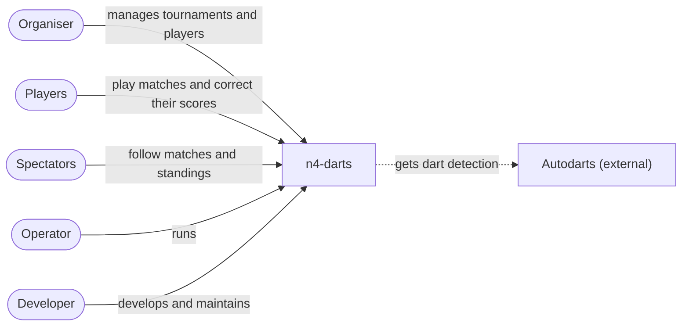
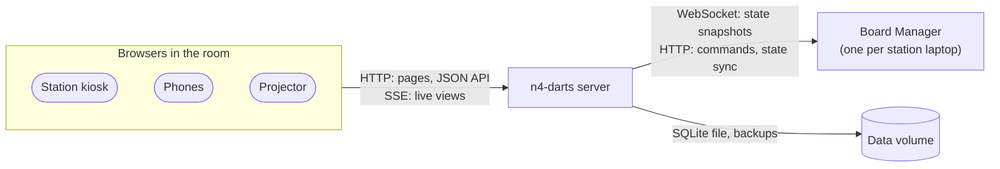

# 3. Context and scope

## 3.1 Business context

Who works with n4-darts, and for what. It describes the business only; how things are built comes later.

- **n4-darts** is the whole thing as the people in the room see it, the automatic dartboards included: they play at it, run tournaments with it and follow along on it. What's inside comes when we zoom in.
- **During an evening** nothing from outside the room is needed (`docs/adr/0005-fully-offline.md`).
- **Autodarts** provides only the dart detection. Scoring, matches and tournaments are n4-darts' own (`docs/adr/0001-autodarts-for-detection-only.md`).
- **Between evenings** the operator keeps n4-darts running, the developer changes it, and the Autodarts vendor may change how detection works.

| Partner | In | Out |
|---|---|---|
| **Organiser** | Tournaments (players, format, seeds), overrides (pause, pin, hold, send back, play now), corrections, players and photos, stations | Queue, tables, bracket, placings, duration estimate, match history, diagnostics |
| **Players** | Match setup (players, settings, order), corrections, added darts, undo, next player, board menu | Live score, checkout routes, game shot, profile and stats |
| **Spectators** | Nothing (a tap on a station on the projector opens its scoreboard) | The whole evening on `/display`, one station on `/watch/n`, the leaderboard |
| **Operator** | Image, configuration (stations, PIN), backups to restore | Backups, diagnostics |
| **Autodarts** | Where each dart landed, takeouts, the board's state | Start, stop, reset, calibrate |

## 3.2 Technical context

| Channel | Between | What goes over it |
|---|---|---|
| **HTTP (JSON)** | Browsers → server | Commands and changes: station commands, quick matches, corrections, everything in `/admin`. The organiser's routes (`/api/admin/*`) need the PIN cookie. |
| **Server-Sent Events** | Server → browsers | Every live view (`/api/*/live`): a station, the projector, the tournament, the matches. A view is sent again only when it changed. Works through a reverse proxy without special configuration (OPS-04). |
| **WebSocket** | Server ← Board Manager | Full state snapshots of the board: darts of the current visit, takeouts, status. The gateway diffs them into events. |
| **HTTP** | Server → Board Manager | `GET /api/state` to resync after a reconnect; start, stop, reset and auto-calibrate. Unauthenticated and unofficial (`docs/board-manager-api.md`). |
| **File system** | Server → data volume | The SQLite database and the daily backups in `backups/`. |

The laptops run nothing of ours: the Board Manager and a browser in kiosk mode pointing at `/station/n`.
