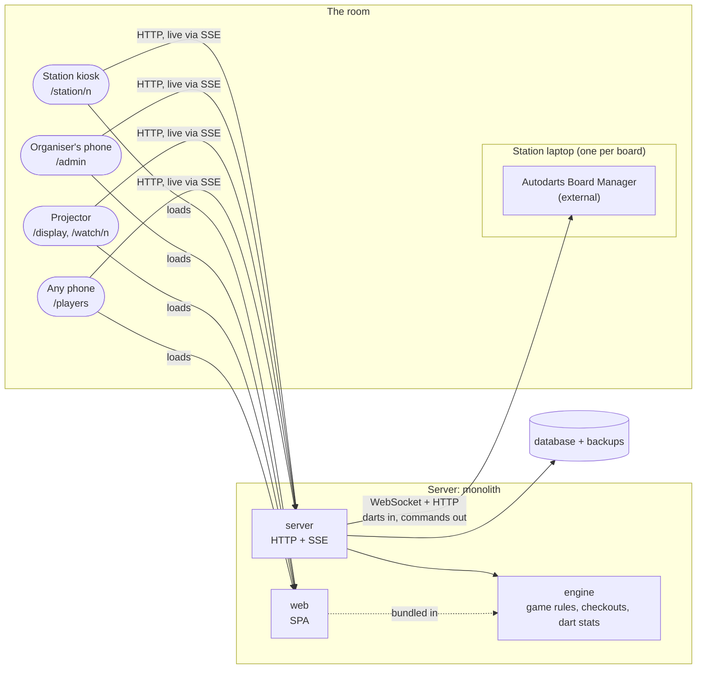
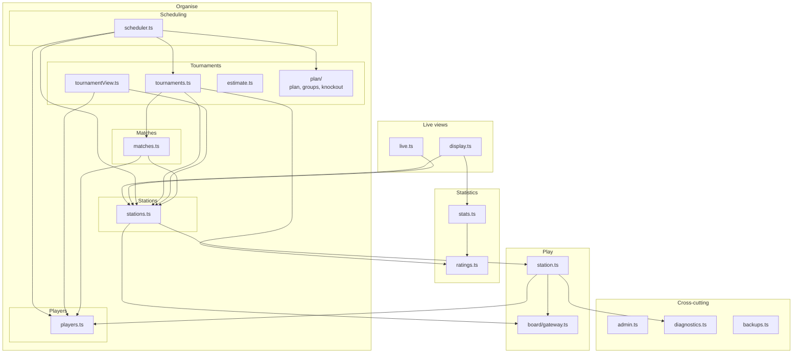

# 5. Building block view

What n4-darts is made of, in two levels: the parts that run (level 1), then what's inside the server and the web app (level 2). Each block is mapped to its cluster in the function overview (section 1.1). Arrows show code dependencies as they are in the code, not as they should be.

## 5.1 Whitebox overall system

**Motivation**

The rules are pure and shared (engine), everything with state or I/O sits in one server process, and the browser app only talks to that server. That keeps the score right in one place and the laptops free of anything of ours.

**Contained building blocks**

| Block                          | What it is                                                                                                                                                                                   | Clusters                                                                             |
| ------------------------------ | -------------------------------------------------------------------------------------------------------------------------------------------------------------------------------------------- | ------------------------------------------------------------------------------------ |
| **engine** (`packages/engine`) | Pure functions with no I/O: X01 rules as a fold over a match's events, checkout routes, and per-match dart stats. Used by the server and bundled into the web app (ADR 0006).                | Match play (rules), Stats (calculations)                                             |
| **server** (`packages/server`) | One process that holds everything else: board connections, stations, players, matches, tournaments, scheduling, stats, live views, access and operations. It serves the web app's files too. | All                                                                                  |
| **web** (`packages/web`)       | The browser app for every page. It talks to the server only over HTTP and SSE, and shares types with it through `@n4/server/api`.                                                            | Match play (at the board), Live views, the organiser's side of Organise, Stats pages |
| **SQLite + backups**           | One database file on the data volume: matches as event logs (ADR 0002), players with photos, tournaments, stations. Daily copies in `backups/`.                                              | Kept by Operations, used by all                                                      |
| **Board Manager**              | Autodarts' software on each station laptop. External; only its local API is used (ADR 0001, `docs/board-manager-api.md`).                                                                    | Dart detection (the far side)                                                        |

For development only:

- **board-sim** (`tools/board-sim`) speaks the Board Manager's protocol, so everything runs and is tested without a real board (Q-14). The server's tests use it.
- **e2e** (`packages/e2e`) starts the server on simulators and drives the web app in a browser with Playwright.

**Important interfaces**

**`@n4/server/api`** (`packages/server/src/api.ts`): the types of every view and request, shared by the server and the web app, so the API is typed end to end. **`@n4/engine`**: the rules, checkout routes and dart stats, imported by both. **Board Manager API**: see section 3.2 and `docs/board-manager-api.md`.

### Board gateway (inside server)

One long-lived WebSocket client per board, configured per station with the Board Manager's address (`packages/server/src/board/gateway.ts`).

- Turns snapshots into events by diffing them against the last one: `DartDetected`, `DartRevised` (Autodarts changed an earlier dart), `TakeoutStarted`, `TakeoutFinished`, `BoardReset`, `BoardStopped`, `BoardStarted`, `BoardOffline`, `BoardOnline`.
- Sends commands: start, stop, reset, auto-calibrate.
- Reconnects with backoff; on reconnect it fetches `GET /api/state` and diffs again, so a dropped connection never loses or duplicates a dart (BOARD-02, Q-03).
- Knows nothing about games; it only speaks "board".

### Engine

Pure, deterministic game rules: `state = fold(rules, events)` (`packages/engine`).

- Input: the match's log: `MatchStarted`, `DartThrown`, `DartCorrected`, `TakeoutFinished`, `VisitUndone`, `VisitEndedManually` and the rest.
- Output: the current state (scores, whose visit, legs, the winner) and what follows from it (busts, legs won, the match won); checkout routes (`checkout.ts`) and per-match dart stats (`stats.ts`).
- No I/O, no clock, no database: easy to test, and it runs in the browser too.
- X01 only so far, versioned (`RULES_VERSION`) so old matches replay under their own rules (PLAY-17).

### Persistence

One SQLite file on the data volume (`packages/server/src/db.ts`):

- **An event log per match**, append-only: every dart, correction and command. A match's state is rebuilt from it, which gives crash recovery, an audit trail, and stats.
- **Plain tables** for players (with photos), tournaments and their entrants, stations, and per-match caches such as leg durations.

## 5.2 Level 2

### White box: server

Modules in `packages/server/src`, one folder per cluster. Components depend on each other in one direction only: the linter fails on any import cycle, type-only imports included (`noImportCycles` in `biome.json`). Only dependencies between clusters are drawn. Every module uses `db.ts` and `api.ts`, and `app.ts` wires them all together, so those three are left out of the diagram.

Each component is layered: **routes over logic over `db.ts`**. A component's Fastify routes are in its own `<component>Routes.ts` (`players/playersRoutes.ts`, …): they read the request, call the logic and turn the logic's errors into status codes. The logic has no HTTP in it, and the linter keeps it that way (`noRestrictedImports` on `fastify` for every file but the route files and `app.ts`). Live streams go through `streamView` in `live/liveRoutes.ts`. The diagram shows the logic only; each routes file depends on its own component's logic, and those that stream on `live/`.

| Folder         | Files                                                                                 | Cluster        | What it does                                                                                                                                                                                                                                                                                                     |
| -------------- | ------------------------------------------------------------------------------------- | -------------- | ---------------------------------------------------------------------------------------------------------------------------------------------------------------------------------------------------------------------------------------------------------------------------------------------------------------- |
| `board/`       | `gateway.ts`                                                                          | Dart detection | One connection per Board Manager. Turns its state snapshots into dart, takeout and board events, sends start, stop, calibrate and reset, and reconnects by itself. Knows nothing about games.                                                                                                                    |
| `stations/`    | `station.ts`                                                                          | Match play     | One station: its match in progress, fed by the gateway and the players' commands at the board. Folds the match's log with the engine and appends to it.                                                                                                                                                          |
| `stations/`    | `stations.ts`, `stationsRoutes.ts`                                                    | Stations       | The list of stations, starting and restarting each one's gateway when its board address changes. Routes: each station's view, stream, commands and board menu, and the organiser's station pages.                                                                                                                |
| `players/`     | `players.ts`, `playersRoutes.ts`                                                      | Players        | The player list: adding, renaming, archiving, deleting, photos; and `matchPlayer` (name and photo for any view).                                                                                                                                                                                                 |
| `matches/`     | `matches.ts`, `matchesRoutes.ts`                                                      | Matches        | The history, one match's detail, and corrections. Offers `ResultGuard` for whoever builds on results. Routes: also putting a match on a station and ending it (the station's own logic).                                                                                                                         |
| `tournaments/` | `tournaments.ts`, `tournamentView.ts`, `estimate.ts`, `plan/`, `tournamentsRoutes.ts` | Tournaments    | Drafting, starting, withdrawals, late players, result changes and ending. `plan/` is the pure part: groups, tables, knockout and the whole plan from config, entrants and results. `tournamentView.ts` puts together what /admin shows of the tournament's own progress. `estimate.ts` is the duration estimate. |
| `scheduling/`  | `scheduler.ts`                                                                        | Scheduling     | The queue, and a tick that gives free stations their next match. Carries out pause, pin, hold, send back and play now with Tournaments. `withQueue` adds the queue to the tournament's view.                                                                                                                     |
| `ratings/`     | `ratings.ts`                                                                          | Ratings        | A player's rating (RATING-01).                                                                                                                                                                                                                                                                                   |
| `stats/`       | `stats.ts`, `statsRoutes.ts`                                                          | Stats          | Profiles, leaderboard and awards, from the engine's per-match stats.                                                                                                                                                                                                                                             |
| `live/`        | `live.ts`, `display.ts`, `liveRoutes.ts`                                              | Live views     | `live.ts`: one change feed for every change. `display.ts`: the projector's view. `liveRoutes.ts`: `streamView`, the SSE stream that resends a view when it changed, and the projector's routes.                                                                                                                  |
| `access/`      | `admin.ts`, `accessRoutes.ts`                                                         | Access         | The PIN and the token a logged-in device keeps; the routes log in and out and guard `/api/admin`.                                                                                                                                                                                                                |
| `operations/`  | `diagnostics.ts`, `backups.ts`, `operationsRoutes.ts`                                 | Operations     | Timings and counters for the diagnostics page; the daily backups.                                                                                                                                                                                                                                                |
| top level      | `db.ts`, `api.ts`, `app.ts`, `main.ts`                                                | Shared         | Storage for all clusters; the types the web app shares; wiring (creating the components and registering their routes); reading the server's configuration and starting it.                                                                                                                                       |

### White box: web app

Every page is one route in `App.tsx`'s route table ([wouter](https://github.com/molefrog/wouter); links are plain `<a href>`, so moving between pages is a full page load), and each page is a feature folder under `packages/web/src/features/`. A feature never imports from another feature: whatever two features use lives in `components/` (UI) or `lib/` (everything else). `admin/` and its tabs count as one feature. The linter enforces this: `noRestrictedImports` in `biome.json`, with one override for the files directly in a feature and one for a folder inside it (the admin tabs); a deeper folder needs a third. Pages that follow something live use `useLive` (SSE), and the station and watch pages use `useStation` on top of it.

| Folder                        | Route                      | Cluster                                                                                   | Files                                      |
| ----------------------------- | -------------------------- | ----------------------------------------------------------------------------------------- | ------------------------------------------ |
| `features/station/`           | `/station/n`               | Match play, Matches (quick match), Players (add on the spot), Dart detection (board menu) | `StationPage.tsx`, `MatchSetup.tsx`        |
| `features/watch/`             | `/watch/n`                 | Live views                                                                                | `WatchPage.tsx`                            |
| `features/display/`           | `/display`                 | Live views                                                                                | `DisplayPage.tsx`                          |
| `features/stats/`             | `/players`, `/players/:id` | Stats                                                                                     | `StatsPages.tsx`, `Heatmap.tsx`            |
| `features/admin/`             | `/admin/*`                 | Access (the PIN prompt), the tabs below                                                   | `AdminPage.tsx`                            |
| `features/admin/tournament/`  | `/admin`                   | Tournaments, Scheduling                                                                   | `TournamentAdmin.tsx`, `TournamentRun.tsx` |
| `features/admin/players/`     | `/admin/players`           | Players                                                                                   | `PlayersAdmin.tsx`, `PhotoEditor.tsx`      |
| `features/admin/matches/`     | `/admin/matches`           | Matches                                                                                   | `MatchesAdmin.tsx`, `MatchHistory.tsx`     |
| `features/admin/stations/`    | `/admin/stations`          | Stations                                                                                  | `StationsAdmin.tsx`                        |
| `features/admin/diagnostics/` | `/admin/diagnostics`       | Operations                                                                                | `DiagnosticsAdmin.tsx`                     |

Shared:

- **`components/`**: the design system's pieces (`Avatar`, `Logo`, `PixelIcon`, `Progress`), and the match pieces more than one page shows: `PlayerCards` and `MatchOver` (station, watch), `PlayerPicker` (station, tournament draft), `SegmentPicker` (station, match corrections), `BoardMenu` (station, admin stations and matches), `Awards` and `MatchCard` (tournament, display).
- **`lib/`**: `useLive`, `useStation`, `usePlayers`, `api.ts` (requests to the server), `darts.ts` (dart labels such as `T20`) and `labels.ts` (rules and legs).
- **`styles/`** and **`assets/`**: the design system's sheets and the logo.

### Observations

Where the code and the function overview don't line up yet:

- **Live views has no single home.** The change feed, `streamView` and the projector's view are in `live/`, but the tournament's view is put together in `app.ts` from `tournamentView.ts` (Tournaments), the queue (Scheduling) and the awards (Stats), and each component streams its own views from its routes file. That's fine while it's small, and it's why the routes of Matches, Stations and Tournaments depend on `live/`.
- **Match play is split between engine and server.** The rules are pure in `engine`; `station.ts` runs them at a station and holds the I/O. That split is on purpose (ADR 0002, ADR 0006). The engine's dart stats are also used by Stats, which is why the engine sits under two clusters.
- **`db.ts` is shared by every cluster.** One module holds all the tables and queries. It keeps the clusters apart from SQL, but it's the one place every change goes through.
