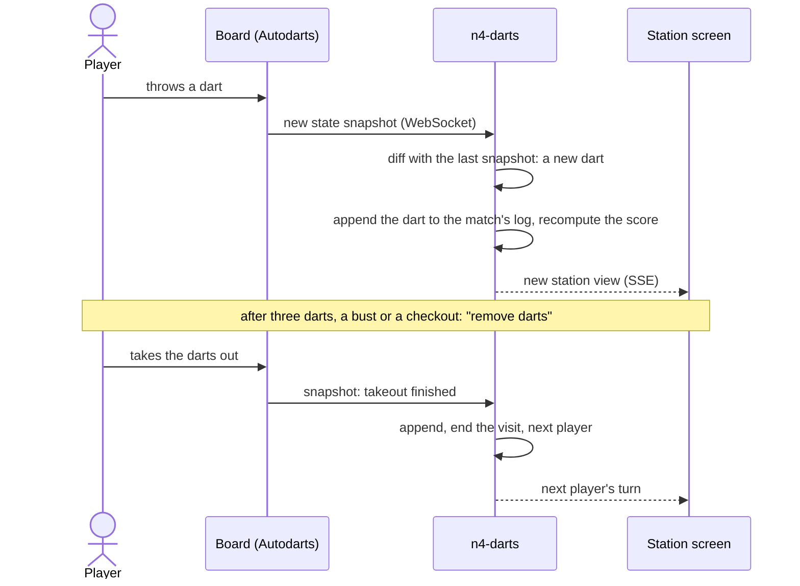
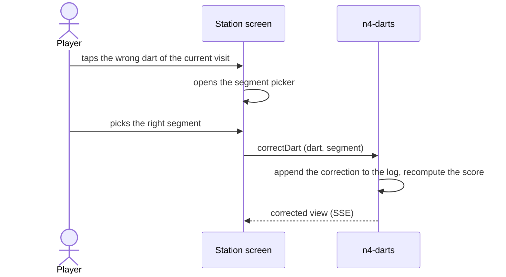
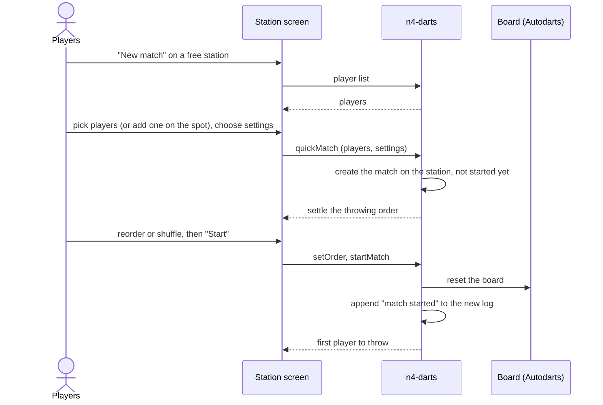
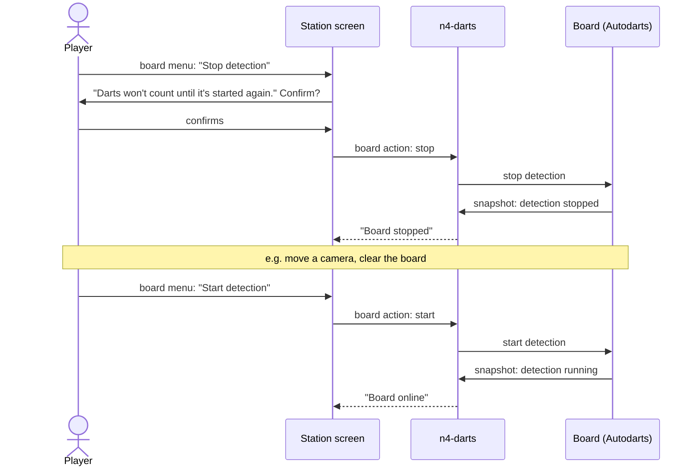
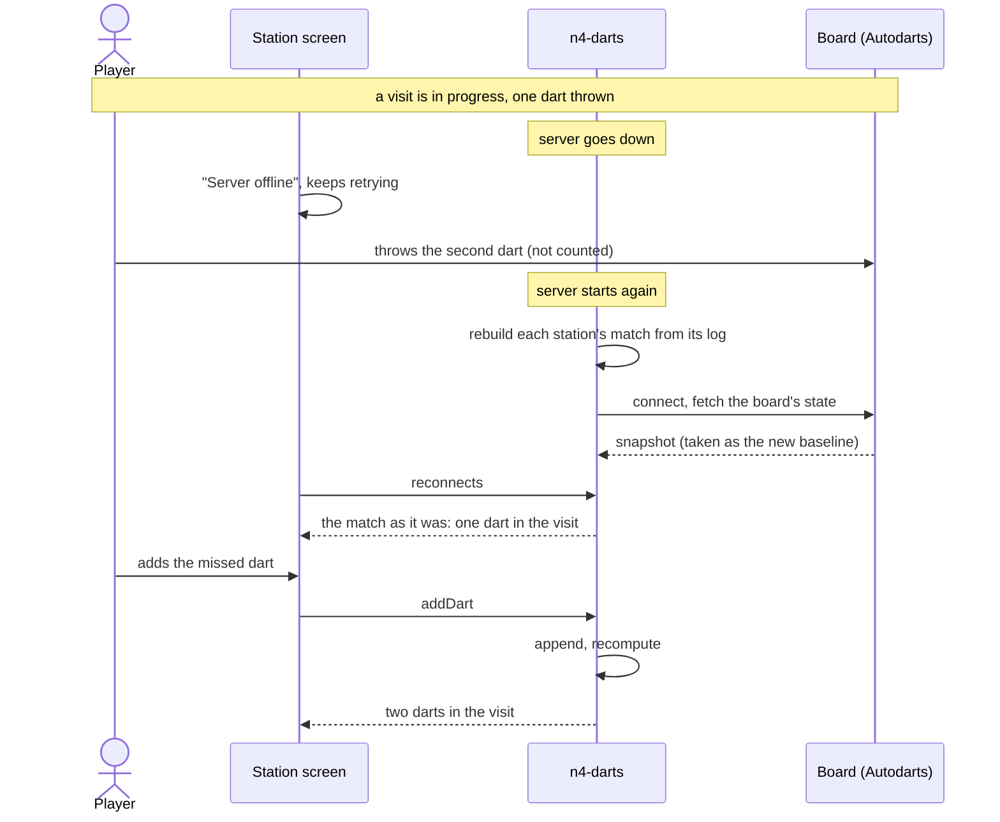
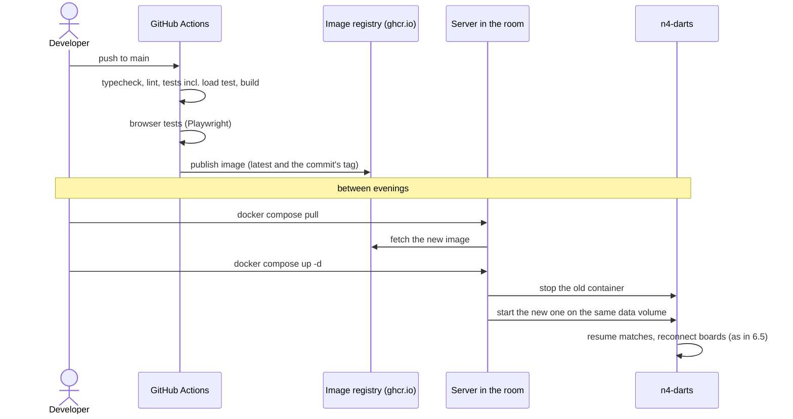

# 6. Runtime view

The participants are kept high level: the **station screen** is the kiosk browser (or any device on `/station/n`), **n4-darts** is the server with its database, the **board** is Autodarts' Board Manager. Other screens following along (`/watch/n`, `/display`, `/admin`) get the same updates as the station screen and are left out.

## 6.1 A player throws a dart in an active match

- The darts count for whoever's visit it is; nobody at the board has to press anything (PLAY-05).
- The visit ends at takeout, not at the third dart (ADR 0003). Darts after the visit is over are ignored and shown as such (PLAY-06).
- If the connection to the board drops, n4-darts reconnects and resyncs with `GET /api/state`, so no dart is lost or counted twice (BOARD-02).
- From the board to the screens within 150 ms (Q-05). Every screen gets a new view only if it changed (section 8.3).

## 6.2 A player corrects a dart detection

- The correction is appended; the original detection stays in the log and the dart stays marked as corrected (PLAY-09, ADR 0002).
- At the station only darts of the current visit can be corrected. A dart the board missed is added the same way (`addDart`, PLAY-10).
- The organiser can correct any dart of any match from `/admin`. For a finished tournament match, n4-darts first checks whether the result may still change (TOUR-14).

## 6.3 Players start a quick match

- No PIN and no organiser needed: quick matches and new players are open at the station (MATCH-01, PLAYER-04, ADMIN-02).
- A busy station refuses a new match. During a tournament, the station and the players count as busy, so the scheduler leaves them alone (SCHED-04).
- The board is reset before the match starts, so darts still on it can't count (BOARD-05).

## 6.4 A player restarts dart detection

- The board menu is on every station page, with no PIN, and on the organiser's station list (BOARD-04). Players never have to leave the kiosk browser for the Board Manager.
- Stopping asks for confirmation; starting doesn't. Calibrating and resetting go the same way.
- The match isn't touched: its log, score and visit stay as they were. Darts thrown while detection is stopped aren't seen and have to be added by hand (PLAY-10).

## 6.5 A match gets interrupted by an outage

The server goes down mid-visit, e.g. a power cut or a restart.

- Every match resumes exactly where its log left off, including the visit in progress (Q-02). Nothing about a match lives only in memory.
- After a restart, darts already on the board are the baseline, not news, so darts thrown during the outage are added by hand (PLAY-10). If the server can't be reached, nobody can play (section 2).
- A short drop of only the board's connection is different: n4-darts reconnects, fetches the board's state and diffs it against the last snapshot it saw, so darts thrown meanwhile are counted, once (BOARD-02, QS-01).

## 6.6 A developer deploys a new version of n4-darts

- An image is only published when every check passes (Q-15). Pull requests run the same checks without publishing.
- An update is pull and restart (OPS-05); all data is on the volume, so nothing is lost. Updating during an evening works, but every station is offline for the restart, like in 6.5.
- Developer and operator are often the same person (section 1.3); the pull and restart are the operator's part.

