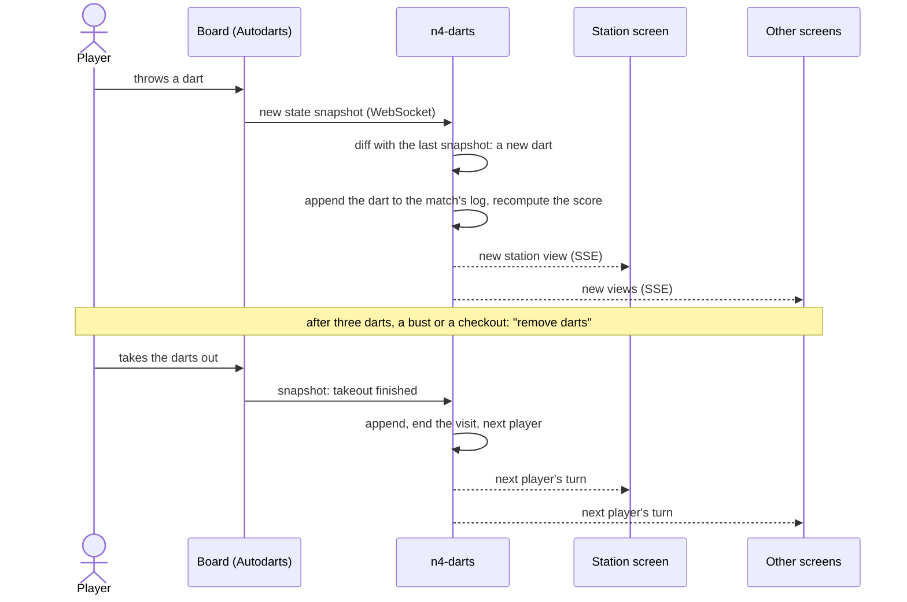
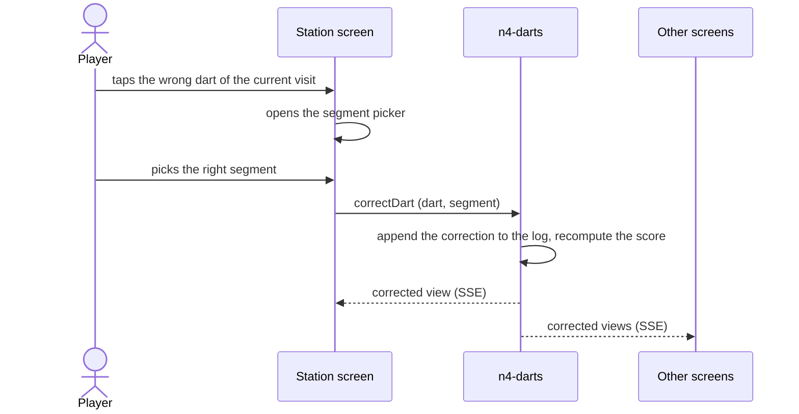
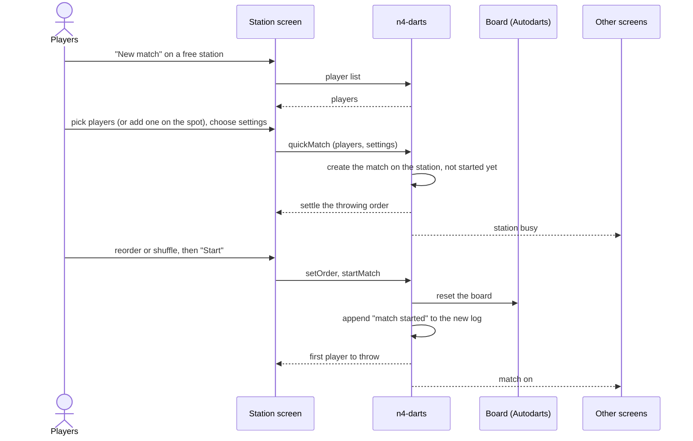

# 6. Runtime view

Three scenarios. The participants are kept high level: the **station screen** is the kiosk browser (or any device on `/station/n`), **n4-darts** is the server with its database, the **board** is Autodarts' Board Manager, and **other screens** are everything else following along (`/watch/n`, `/display`, `/admin`).

## 6.1 A player throws a dart in an active match

- The darts count for whoever's visit it is; nobody at the board has to press anything (PLAY-05).
- The visit ends at takeout, not at the third dart (ADR 0003). Darts after the visit is over are ignored and shown as such (PLAY-06).
- If the connection to the board drops, n4-darts reconnects and resyncs with `GET /api/state`, so no dart is lost or counted twice (BOARD-02).
- From the board to the screens within 150 ms (Q-05). Every screen gets a new view only if it changed (section 8.3).

## 6.2 A player corrects a dart detection

- The correction is appended; the original detection stays in the log and the dart stays marked as corrected (PLAY-09, ADR 0002).
- At the station only darts of the current visit can be corrected. A dart the board missed is added the same way (`addDart`, PLAY-10).
- The organiser can correct any dart of any match from `/admin`. For a finished tournament match, n4-darts first checks whether the result may still change (TOUR-14).

## 6.3 Players start a quick match

- No PIN and no organiser needed: quick matches and new players are open at the station (MATCH-01, PLAYER-04, ADMIN-02).
- A busy station refuses a new match. During a tournament, the station and the players count as busy, so the scheduler leaves them alone (SCHED-04).
- The board is reset before the match starts, so darts still on it can't count (BOARD-05).
