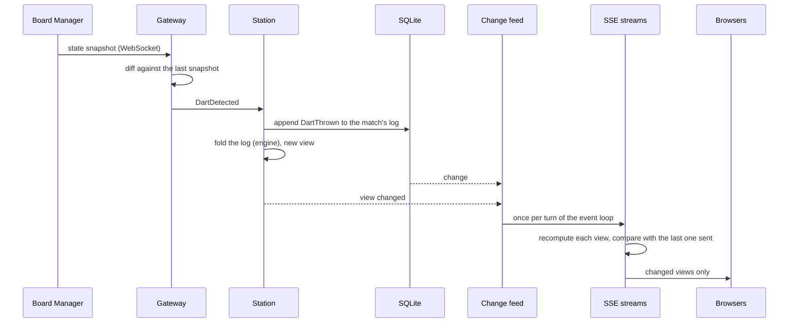

# 6. Runtime view

## 6.1 A dart, from the board to the screens

- The station appends the dart before it updates its own view; the change feed waits for both and calls its listeners at most once per turn of the event loop.
- Every open stream recomputes its view (station, projector, tournament, matches) and sends it only if it's different from the last one it sent. Q-05 asks for under 150 ms from the board to the screens; the diagnostics page shows it for the last 20 darts.
- Darts after the visit is over (waiting for takeout) are ignored and shown as such; darts while nobody is playing are ignored (PLAY-06, PLAY-14).

## 6.2 Playing a tournament match

1. The scheduler's tick (every 2 s, and after every change) finds a free station and gives it the next ready match: both players free, longest-rested first (SCHED-01).
2. `/station/n` shows the match; the players settle the order and press **Start**. The server resets the board (`MatchStarted`).
3. Each dart is scored as in 6.1. After three darts, a bust or a checkout, the station shows "remove darts"; `TakeoutFinished` ends the visit and the next player throws.
4. When the match is won, the station shows "Game shot". **Done**, or 60 s after the checkout, closes the match and frees the station (SCHED-03).
5. Tournaments rebuilds its plan from the results: tables, the knockout draw, the next matches. The scheduler gives the station its next match.

## 6.3 Correcting a dart

- **At the station:** tapping a dart of the current visit opens the segment picker; `DartCorrected` is appended and the original detection stays in the log (PLAY-09). A dart the board missed is added as the visit's next dart (PLAY-10).
- **By the organiser:** any dart of any match, running or finished (MATCH-05). Before the correction is stored, Matches asks its `ResultGuard` whether the result may change; for a tournament match, Tournaments refuses if a later match that depends on it has started (TOUR-14). After it, the result, the tournament and every stat follow (STATS-07).

## 6.4 Restarts

- **Server restarts:** every match in progress is rebuilt from its log, including the visit in progress (Q-02); the gateways reconnect and resync with `GET /api/state`.
- **Laptop or browser restarts:** the kiosk page reconnects and the current view is pushed again.
- **Board Manager restarts or drops off:** the station shows the board offline; play resumes when it's back. Darts thrown meanwhile have to be added by hand (PLAY-10).
