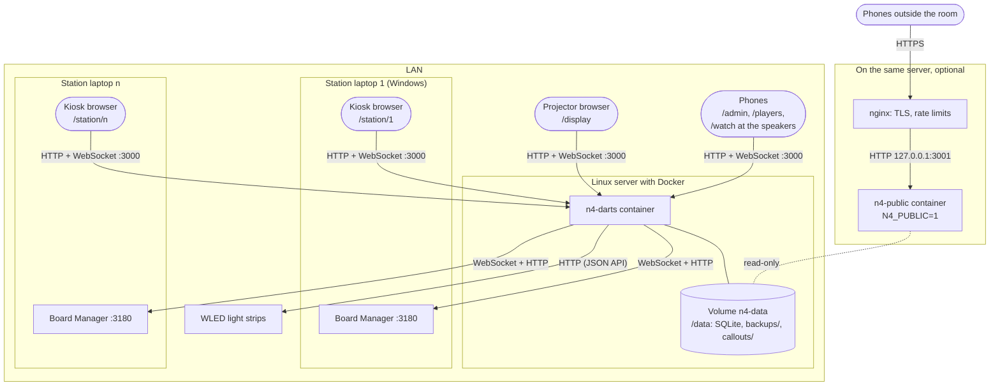

# 7. Deployment view

## 7.1 Infrastructure level 1

**Motivation**

One server in the room holds everything; the laptops only run what they already have (the Board Manager) plus a browser. The room keeps working with the internet unplugged.

**Quality and performance features**

Restart policy `unless-stopped`; all state on the volume, so a container can be replaced at any time between evenings. Backups stay on the same volume unless the operator copies the folder elsewhere (Q-07).

**Mapping of building blocks to infrastructure**

The container runs `server` with the built `web` files (the default caller voice among them) and `engine`; `/data` holds the database, backups and uploaded voice packs (`callouts/`). The packs aren't in the backups; a pack can be uploaded again. The Board Manager and the browsers are on the laptops, the projector and phones.

## 7.2 Infrastructure level 2

### The container

- **Image:** `ghcr.io/sverbach/n4-darts:latest`, built by CI from the `Dockerfile`
- **Configuration** (environment, see `docker-compose.yml`):

| Variable    | Default                   | What                                                                                                                                                                      |
| ----------- | ------------------------- | ------------------------------------------------------------------------------------------------------------------------------------------------------------------------- |
| `PORT`      | `3000`                    | HTTP port inside the container (`N4_PORT` maps it on the host).                                                                                                           |
| `DATA_DIR`  | `/data`                   | Database, `backups/` and uploaded voice packs (`callouts/`).                                                                                                              |
| `STATIONS`  | `1=http://localhost:3180` | Seeds the stations on the very first start (`number=Board Manager address`, comma-separated). Afterwards stations are managed in `/admin` and this is ignored (ADMIN-04). |
| `ADMIN_PIN` | empty                     | The shared PIN for `/admin`. Empty leaves it open, with a warning (ADMIN-01).                                                                                             |
| `N4_PUBLIC` | empty                     | `1` starts the public site instead (ADR 0008): only the public read routes, the database opened read-only, nothing running in the background.                            |
| `N4_PUBLIC_PIN` | empty                 | The public site's shared password. Required with `N4_PUBLIC=1`; without it the process exits.                                                                             |

### The public site (optional)

- **Container:** `n4-public` in `docker-compose.yml`, from the same image, under the `public` profile: `N4_PUBLIC_PIN=… docker compose --profile public up -d`. It mounts `n4-data` read-only and listens on `127.0.0.1:${N4_PUBLIC_PORT:-3001}` only.
- **Database:** it opens the room's SQLite file read-only, next to the room's server (WAL lets it read while the room writes). It needs the room's server to have opened the database first; until then it exits and Docker restarts it.
- **nginx** in front (`docs/nginx-public.conf`): TLS, only the public container proxied, rate limits on the login and the API, `X-Robots-Tag: noindex`.

- **Update:** `docker compose pull && docker compose up -d` (OPS-05).
- **Restore:** stop the server, put a backup file in place of the database, start again (OPS-02).

### Network and trust

- Fixed IPs (DHCP reservations) for the laptops and the server; each station's Board Manager address is set in `/admin` → Stations.
- No player logins. `/admin` is behind a shared PIN so a guest can't edit by accident (ADR 0004).
- The Board Manager is unauthenticated, so anyone on the network can reset a board. Accepted for a private room.
- WLED's API is unauthenticated too: give the controllers fixed IPs and enter them in `/admin` → Lights (ADR 0009).
- A reverse proxy is optional; it must forward WebSocket upgrades for the live views, and needs nothing else (OPS-04, ADR 0011, README "Behind a reverse proxy"). The room's server must not be exposed to the internet (Q-12); the public site is the one way in from outside, read-only and behind its password (ADR 0008).
