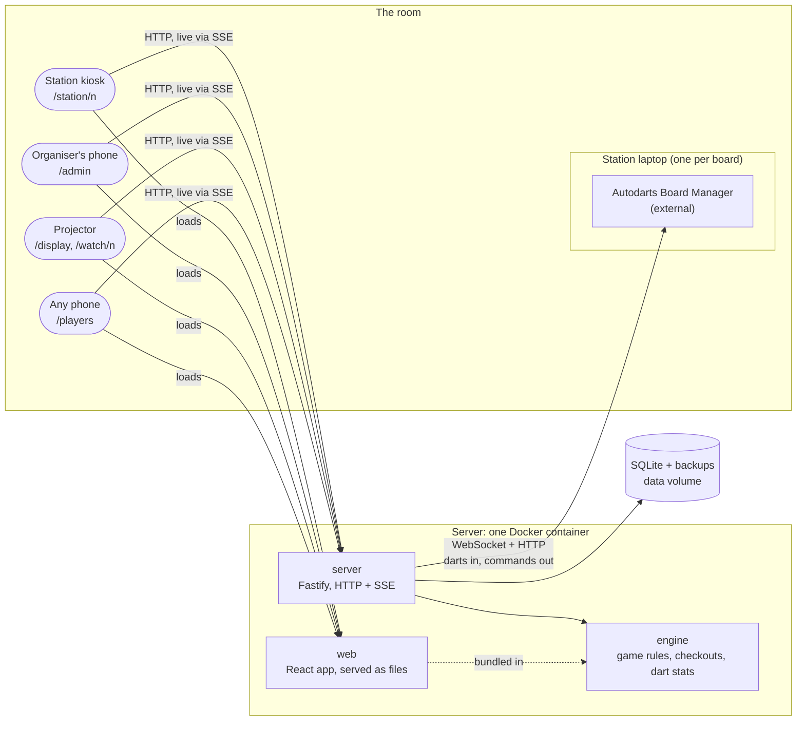
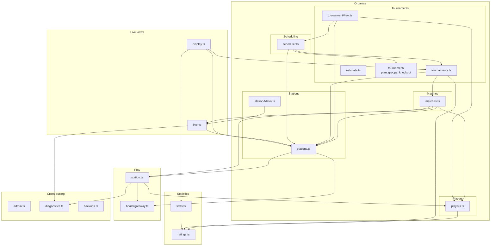

# Building blocks

What n4-darts is made of, in two levels: the parts that run (level 1), then what's inside the server and the web app (level 2). Each block is mapped to its cluster in `functions.md`. Arrows show code dependencies as they are in the code, not as they should be.

Status: **draft** (2026-10-31), for review.

## Level 1: the system

| Block | What it is | Clusters |
|---|---|---|
| **engine** (`packages/engine`) | Pure functions with no I/O: X01 rules as a fold over a match's events, checkout routes, and per-match dart stats. Used by the server and bundled into the web app (ADR 0006). | Match play (rules), Stats (calculations) |
| **server** (`packages/server`) | One process that holds everything else: board connections, stations, players, matches, tournaments, scheduling, stats, live views, access and operations. It serves the web app's files too. | All |
| **web** (`packages/web`) | The browser app for every page. It talks to the server only over HTTP and SSE, and shares types with it through `@n4/server/api`. | Match play (at the board), Live views, the organiser's side of Organise, Stats pages |
| **SQLite + backups** | One database file on the data volume: matches as event logs (ADR 0002), players with photos, tournaments, stations. Daily copies in `backups/`. | Kept by Operations, used by all |
| **Board Manager** | Autodarts' software on each station laptop. External; only its local API is used (ADR 0001, `docs/board-manager-api.md`). | Dart detection (the far side) |

For development only:
- **board-sim** (`tools/board-sim`) speaks the Board Manager's protocol, so everything runs and is tested without a real board (Q-14). The server's tests use it.
- **e2e** (`packages/e2e`) starts the server on simulators and drives the web app in a browser with Playwright.

## Level 2: inside the server

Modules in `packages/server/src`, grouped by cluster. Only dependencies between clusters are drawn. Every module uses `db.ts` and `api.ts`, and `app.ts` wires them all together, so those three are left out of the diagram.

| Module | Cluster | What it does |
|---|---|---|
| `board/gateway.ts` | Dart detection | One connection per Board Manager. Turns its state snapshots into dart, takeout and board events, sends start, stop, calibrate and reset, and reconnects by itself. Knows nothing about games. |
| `station.ts` | Match play | One station: its match in progress, fed by the gateway and the players' commands at the board. Folds the match's log with the engine and appends to it. |
| `stations.ts`, `stationAdmin.ts` | Stations | The list of stations, starting and restarting each one's gateway when its board address changes, and the organiser's station pages. |
| `players.ts` | Players | The player list, photos, archiving, and `matchPlayer` (name and photo for any view). |
| `matches.ts` | Matches | The organiser's matches: put one on a station, the history, the detail of one match, and corrections. Offers `ResultGuard` for whoever builds on results. |
| `tournaments.ts`, `tournament/`, `tournamentView.ts`, `estimate.ts` | Tournaments | Drafting, starting, withdrawals, late players, result changes and ending. `tournament/` is the pure part: groups, tables, knockout and the whole plan from config, entrants and results. `tournamentView.ts` puts together what /admin shows. `estimate.ts` is the duration estimate. |
| `scheduler.ts` | Scheduling | The queue, and a tick that gives free stations their next match. Carries out pause, pin, hold, send back and play now with Tournaments. |
| `ratings.ts` | Ratings | A player's rating (RATING-01). |
| `stats.ts` | Stats | Profiles, leaderboard and awards, from the engine's per-match stats. |
| `live.ts`, `display.ts` | Live views | `live.ts`: one change feed and the SSE streams that resend a view when it changed. `display.ts`: the projector's view. |
| `admin.ts` | Access | The PIN and its cookie in front of `/api/admin`. |
| `diagnostics.ts`, `backups.ts` | Operations | Timings and counters for the diagnostics page; the daily backups. |
| `db.ts`, `api.ts`, `app.ts`, `main.ts` | Shared | Storage for all clusters; the types the web app shares; wiring the modules into routes; reading the server's configuration and starting it. |

## Level 2: inside the web app

Every page is one route in `App.tsx`. Pages that follow something live use `useLive` (SSE), and the station uses `useStation` on top of it.

| Page | Route | Cluster | Main files |
|---|---|---|---|
| Home | `/` | – | `App.tsx` |
| Station | `/station/n` | Match play, Matches (quick match), Players (add on the spot), Dart detection (board menu) | `StationPage.tsx`, `MatchSetup.tsx`, `SegmentPicker.tsx`, `BoardMenu.tsx`, `useStation.ts` |
| Watch | `/watch/n` | Live views | `WatchPage.tsx` |
| Display | `/display` | Live views | `DisplayPage.tsx` |
| Players and profile | `/players`, `/players/:id` | Stats | `StatsPages.tsx`, `Heatmap.tsx` |
| Admin: tournament | `/admin` | Tournaments, Scheduling | `TournamentAdmin.tsx`, `TournamentRun.tsx` |
| Admin: players | `/admin/players` | Players | `PlayersAdmin.tsx`, `PhotoEditor.tsx` |
| Admin: matches | `/admin/matches` | Matches | `MatchesAdmin.tsx`, `MatchHistory.tsx` |
| Admin: stations | `/admin/stations` | Stations | `StationsAdmin.tsx` |
| Admin: diagnostics | `/admin/diagnostics` | Operations | `DiagnosticsAdmin.tsx` |

Shared: `Avatar.tsx`, `Logo.tsx`, `PixelIcon.tsx`, `Progress.tsx` and `styles/` (the design system), `adminApi.ts` (requests from the admin pages; the PIN prompt is in `AdminPage.tsx`), `darts.ts` (dart labels such as `T20`).

## Observations

Where the code and `functions.md` don't line up yet:

- **Tournaments and Scheduling depend on each other.** The scheduler needs Tournaments for the next ready match. But `tournamentView.ts` takes the queue from `scheduler.ts` (`queueOf`) to show it in /admin, so the modules form a loop: `tournaments.ts` → `tournamentView.ts` → `scheduler.ts` → `tournaments.ts`. It's the same pattern as the awards before one-way-dependencies ticket 02: a view inside Tournaments reaching for something another cluster owns. The same fix would work here: the route adds the queue from Scheduling.
- **Players depends on Ratings.** The organiser's player list shows each player's rating (`players.ts` → `ratings.ts`). `functions.md` has Players depending on nothing. Either the arrow goes in `functions.md` (Players → Ratings, harmless: Ratings only needs Matches), or the rating is added by the route, as the awards are now.
- **Live views has no single home.** The streams are in `live.ts` and the projector's view is in `display.ts`, but the tournament's view is in `tournamentView.ts` (Tournaments) and the match detail's stream is registered in `matches.ts`. That's fine while it's small, and it's why Matches and Stations depend on `live.ts`.
- **Match play is split between engine and server.** The rules are pure in `engine`; `station.ts` runs them at a station and holds the I/O. That split is on purpose (ADR 0002, ADR 0006). The engine's dart stats are also used by Stats, which is why the engine sits under two clusters.
- **`db.ts` is shared by every cluster.** One module holds all the tables and queries. It keeps the clusters apart from SQL, but it's the one place every change goes through.
