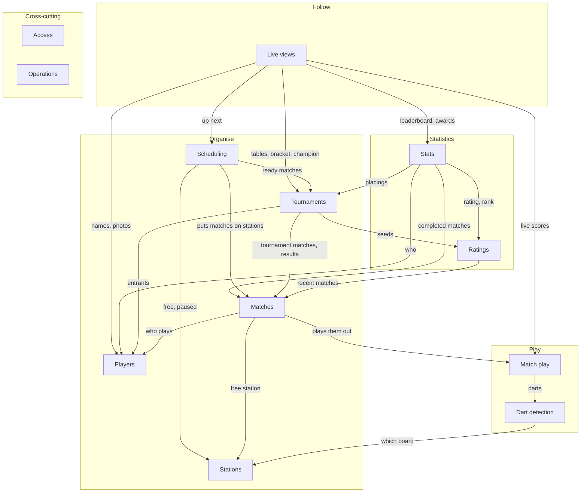

# Function overview

The functions of n4-darts, clustered by what they're for, and how the clusters depend on each other. It stays at the business level: what each cluster does, not how it's built. Requirement IDs refer to `requirements.md`; stakeholders to `stakeholders.md`.

Status: **draft** (2026-10-26), for review.

## Clusters

The clusters fall into five groups:
- **Play**: what happens at the board.
- **Organise**: what the organiser sets up and the evening runs on.
- **Statistics**: the long-term numbers about each player, built up from their finished matches over many evenings.
- **Follow**: what everyone watches.
- **Cross-cutting**: what applies to all of them.

| Cluster | What it does | Requirements | Depends on |
|---|---|---|---|
| **Dart detection** | Hears every dart a station's board detects, knows the board's state (online, stopped, offline), and starts, stops, calibrates and resets the board. | BOARD-01 to 05 | Stations |
| **Match play** | Plays a match by the rules: scores darts, ends visits at takeout, busts, in and out rules, legs and the winner. Lets the players at the board correct and add darts, undo, move to the next player, and shows checkout routes. | PLAY-01 to 17 | Dart detection |
| **Stations** | The places to play: which stations exist, which board each one uses, and whether each one is free, busy or paused. | ADMIN-03, 04 | – |
| **Players** | The list of players across evenings: names, archiving, photos, adding someone on the spot. | PLAYER-01 to 07 | – |
| **Matches** | Every match as a whole: quick matches and single matches put on a free station, ending a match without a result, the record and history of every match, and the organiser's corrections to any dart. | MATCH-01 to 05 | Match play, Stations, Players |
| **Tournaments** | One evening's competition: draft, format, seeding, groups and their tables, the knockout, placings, withdrawals, late arrivals, result changes, ending early, and the duration estimate. | TOUR-01 to 17 | Matches, Players, Ratings |
| **Scheduling** | Runs the evening: gives free stations the next ready match, hands stations over when matches finish, and carries out the organiser's overrides (pause, pin, hold, send back, play now). | SCHED-01 to 08 | Tournaments, Matches, Stations |
| **Ratings** | Each player's rating: their recent average, from their last completed matches. | RATING-01 | Matches |
| **Stats** | Long-term numbers per player: profile, chart, heatmap, leaderboard, and the awards of a finished tournament. | STATS-01 to 07 | Matches, Players, Ratings, Tournaments |
| **Live views** | What the room follows: every screen kept up to date, the projector view of the whole evening, and any station's scoreboard on its own. | VIEW-01 to 06 | Match play, Tournaments, Scheduling, Stats, Players |
| **Access** | Keeps the organiser's functions behind a shared PIN, while everything players need stays open. | ADMIN-01, 02 | – (guards the organiser's functions) |
| **Operations** | Backups and restoring them, diagnostics, updates. | OPS-01 to 05 | – (looks after all of them) |

## Dependencies

An arrow means "depends on": it needs what the other cluster provides.

Access and Operations have no arrows: they apply to every cluster rather than depending on one. Access guards the organiser's side of Players, Matches, Tournaments, Scheduling and Stations. Operations backs up everything that's kept, and its diagnostics watch Dart detection and Live views.

## Observations

- **Match play is the core, and it depends on almost nothing.** Only Dart detection is below it. It's the part that has to be right every dart, and the part that is easiest to keep right in isolation (`docs/adr/0002-match-state-from-event-log.md`).
- **Live views depend on most clusters, and nothing depends on them.** They only consume, so they can change freely without breaking anything below.
- **Tournaments builds on Matches, and Matches doesn't know about Tournaments.** A correction to a finished tournament match must first ask whether the result may change (TOUR-14). Matches offers a "may this result change?" check, and Tournaments plugs its rule into it (`ResultGuard` in `packages/server/src/matches.ts`). So the dependency points one way only.
- **Ratings are their own cluster on purpose, inside Statistics.** Tournaments need a rating for seeding, and Stats shows tournament placings. If rating were part of Stats, Tournaments and Stats would depend on each other. Ratings depend only on Matches, so the loop doesn't arise. Organise reaches into Statistics only for the rating.
- **Awards sit in Stats, but belong to a tournament.** They're computed from a tournament's matches with the stats calculations, and shown at the end of a tournament. Only Live views needs them: the views add them to the tournament from Stats (`withAwards` in `packages/server/src/stats.ts`), so Stats depending on Tournaments stays one-way.
- **The duration estimate sits in Tournaments, but learns from Matches.** It uses the leg lengths of past matches (TOUR-16), which is part of Tournaments' dependency on Matches.
- **Stations is shared by Play and Organise.** Dart detection needs it for which board to listen to; Matches and Scheduling for which station is free. It's the one place both sides meet.
