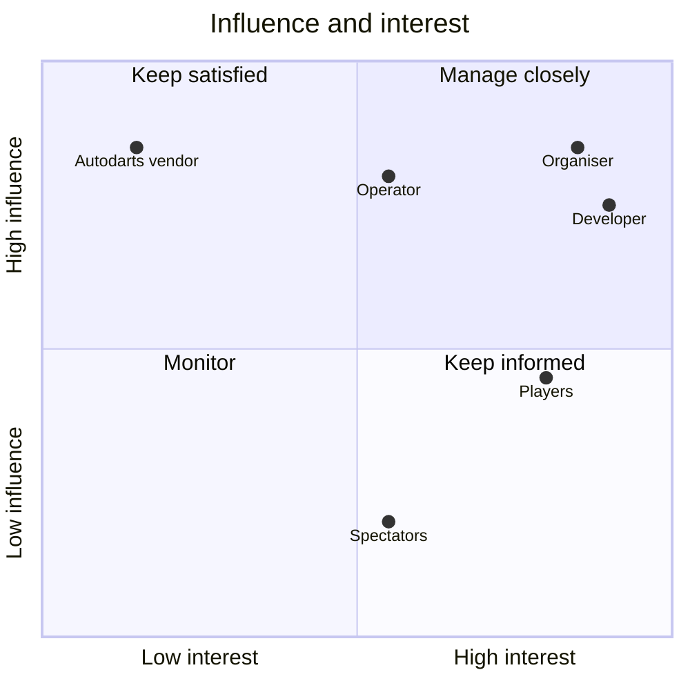
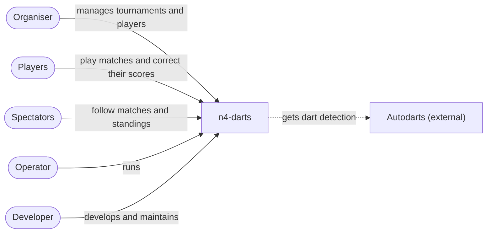

# Stakeholders

Who has a stake in n4-darts, what each of them cares about, and how the system meets them. Terms follow `GLOSSARY.md`.

Status: **draft** (2026-10-26), for review.

## Overview

| Stakeholder            | Who                                                                         | Role                                                                                                                                             | Main concerns                                                                                                                                                                            | Influence | Interest |
| ---------------------- | --------------------------------------------------------------------------- | ------------------------------------------------------------------------------------------------------------------------------------------------ | ---------------------------------------------------------------------------------------------------------------------------------------------------------------------------------------- | --------- | -------- |
| **Organiser**          | Runs the tournament evening; usually also the host                          | Creates the tournament, picks and seeds players, watches the queue, holds or pins matches, corrects results, ends the evening                    | The evening runs itself once started. Setup is quick on a phone. The draw and order are fair. Mistakes can be fixed (corrections, withdrawals, late arrivals). A reliable time estimate. | High      | High     |
| **Players**            | Everyone who throws a match, regulars and guests                            | Play at a station, follow their score, correct the board, look at their stats                                                                    | The score is right, and any mistake is quick to fix at the board. Darts show up at once. Waiting is fair and they know when they're up. A history and rating across evenings.            | Medium    | High     |
| **Spectators**         | Anyone in the room watching: players between matches, guests who don't play | Read the projector (`/display`) or a station's screen (`/watch/n`)                                                                               | Readable from across the room. Live, with no refresh. Who's playing, who's next, the standings.                                                                                          | Low       | Medium   |
| **Operator**           | Runs the server and the room's equipment                                    | Deploys and updates the Docker image, keeps backups, looks after the network, reverse proxy and station laptops, points stations at their boards | Works with the internet unplugged. No data loss. Easy to deploy and update. A slow or broken evening can be explained afterwards (diagnostics).                                          | High      | Medium   |
| **Developer**          | Builds and maintains n4-darts                                               | Changes the code, tests, docs and CI                                                                                                             | Changes are safe and easy to make. Tests catch regressions, including performance. Typed end to end. Decisions are written down (ADRs).                                                  | High      | High     |
| **Autodarts (vendor)** | The company behind the detection system                                     | Ships the Board Manager software and its API, and owns detection                                                                                 | Their product is used as intended (detection only). Their API can change between versions, has no authentication, and is only partly documented.                                         | High      | Low      |

Organiser, operator and developer are often the same person. They're listed separately because their concerns differ and can pull against each other. For example:

- The organiser wants a feature tonight.
- The operator wants nothing to change before an evening.
- The developer wants it done properly.

### Sub-roles worth keeping apart

- **The player at the board** uses the station kiosk to correct a dart, add a dart the board missed, undo, or press "Next player". They need large targets, few taps, and trust that the score on screen is the score.
- **Guests** play a quick match without being regulars. They can join without logging in (`docs/adr/0004-no-logins-stations-are-urls.md`), and either get their own player on the spot, which keeps a history like everyone else's, or play as the shared **Guest** player. The shared player is a convention: a player named "Guest", not a feature. Two consequences:
  - Its stats and rating mix different people.
  - A match can't have the same player twice, so only one guest per match can use it.
- **Players as the people the data is about.** Photos, match history and ratings persist across evenings. The room is private and nothing leaves it (`docs/adr/0005-fully-offline.md`), but the data is still about real people. A player can be archived or deleted, and a photo removed.

## Influence and interest

- **Manage closely: organiser, developer, operator.** Their concerns drive the design and the ADRs.
- **Keep satisfied: Autodarts.** They don't care about n4-darts, but a Board Manager update can break it. The board is kept behind one gateway (`docs/adr/0001-autodarts-for-detection-only.md`), and the simulator and recorded sessions keep our understanding of their API testable.
- **Keep informed: players and spectators.** They don't decide anything, but the evening is for them. Their concerns show up as requirements on the station, `/display` and `/watch`: live updates, readability, fast correction.

## Context

Who works with n4-darts, and for what. It describes the business only; how things are built comes later.

- **n4-darts** is the whole thing as the people in the room see it, the automatic dartboards included: they play at it, run tournaments with it and follow along on it. What's inside comes when we zoom in.
- **During an evening** nothing from outside the room is needed (`docs/adr/0005-fully-offline.md`).
- **Autodarts** provides only the dart detection. Scoring, matches and tournaments are n4-darts' own (`docs/adr/0001-autodarts-for-detection-only.md`).
- **Between evenings** the operator keeps n4-darts running, the developer changes it, and the Autodarts vendor may change how detection works.

## Decisions

- **The station kiosk isn't a stakeholder of its own.** Its needs are the player-at-the-board's.
- **Guests keep a history.** A guest who plays as their own player keeps it like any regular. A guest who doesn't want their own player plays as the shared "Guest" player.
